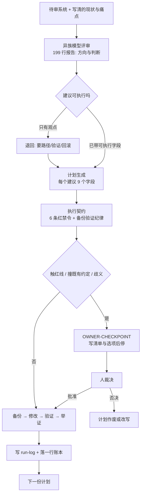

# 让异族模型审你的 agent 配置，再把它的建议安全落地

四轮外部咨询，最后一轮产出了 10,866 行改进计划。真正让这些东西落地的，不是模型有多聪明，而是一份 27 行的执行契约和一本 34 行的账本。下面这套流程我完整跑过一遍，可以照抄。

## 一、为什么值得请“异族”模型来审

你把自己的 agent 系统写进 prompt，交给同一个模型审，多半会得到一句“这套设计很扎实”。原因不神秘：它和你共用同一批上下文，你的假设就是它的假设。你写“bot 必须有 goal”，它就会论证 goal 为什么重要；你漏掉的裂缝，它也会一起漏掉。

异族评审的价值只有一条：它没有你的上下文惯性。它读到的只有你写下来的现状，而不是你以为的现状。

这次实操里三个环节分别用了三个模型族：评审是 Gemini 系，被审系统默认跑 GLM 系，执行计划的是 DeepSeek 系。谁都不了解对方的“顺手写法”，所以“它居然这么理解”本身就是信号。

但异族评审有个必须提前接受的代价：它会产出远超你能消化的量。第一轮报告 199 行，六个板块，Top 5 建议加三个专项，末尾还有一节“不建议动的部分”。这最后一节其实最有价值——它敢说某块设计是过度设计，也敢说某些看起来该改的地方不值得改。

要让这一轮问对问题，prompt 里得放三样东西：owner 画像（包括工作方式上的真实摩擦）、已知痛点清单（越具体越好，比如“某类脚本会静默停摆”）、以及现存的约束体系。缺了这些，你拿回的是一份通用最佳实践清单。

```yaml
# 评审请求的输出契约（节选）
output:
  - 系统级诊断：哪些设计应坚持，哪些是过度设计或脆弱点
  - top_5: 问题 → 根因 → 具体改法（落到 config/skill/cron/流程层）→ 收益 → 风险
  - 专项: 稳定性 / 记忆体系 / owner 效率
  - pushback: 明确列出"不该动"的设计及理由
constraints:
  - 直接、具体、可执行；反对意见必须说
  - 简体中文；不写客套与空泛扩展
```

## 二、评审产物必须可执行，否则只是观点

“改为单源编译”是一句正确的话，但它不是一个可执行的动作。要落地得知道：改哪两个文件、注入标记长什么样、写入要不要原子化、改完跑什么命令验证、出错怎么退回去。

所以第二轮不是继续聊天，而是要求模型为每一条被批准的建议写一份自包含的执行计划。计划格式被固定成九个字段，缺一个就不算完成：

```text
1. 目标与验收标准（可验证的 DONE WHEN）
2. 影响面清单：每个新建/修改/删除文件的绝对路径 + 当前状态
3. 前置检查：动手前必须跑的只读命令
4. 备份步骤：具体命令与目标目录
5. 分步执行：每步给出具体内容/代码块/diff，关键脚本给完整可运行代码
6. 验证步骤：每项检查的命令与预期输出
7. 回滚方案：具体命令
8. 门禁级别 + OWNER-CHECKPOINT 标记
9. 失败隔离：哪步失败应中止，哪步失败可跳过并记录
```

产出是 4 批文本、10,866 行、14 份计划，单份平均 776 行——是那份 199 行报告的 55 倍。另外两项当时被推迟讨论的建议，后来单独写成了第 15、16 号计划。

为什么值得写这么长？因为执行者是非交互 agent，在它的会话里只能看到“一个计划文件 + 文件末尾的硬约束”。计划就是它的全部世界。你省下的每一行，最后都会变成它的一次即兴发挥。

即便如此，计划里的代码也不是都能跑。第 2 号计划自带的反推脚本把顶层分类目录和叶子技能名混在同一个集合里，遍历时又不跟随符号链接，直接漏掉 90 个可用技能。执行者没有照抄，改成两层遍历加 CLI 快照断言。这是这套流程里最该被预期的事：模型写的代码是草案，不是成品。

## 三、落地靠契约，不靠自觉

16 份计划交给自主 agent 顺序执行，人不在场。这时候“别乱来”必须变成可判定的条目，而不是一句叮嘱。这就是执行契约的存在理由——它只有 27 行，但把“不可逆”和“可逆”分开写在最前面：

```markdown
## 绝对禁令（Red — 停下并报告）
1. 永不修改 agent 运行时本体源码；修复只落在 config / scripts / skills
2. 永不重启服务、不动 systemd、不 kill 进程、不执行自更新
3. 永不碰凭证、密钥、token、.env（只读引用可以）
4. 永不对外发布、发消息、代 owner 表态
5. 永不 force-push、不改写 git 历史、不删会话与记忆库
6. 永不未备份就删除或覆盖文件

## 必须遵守的纪律（Yellow — 备份 → 修改 → 验证 → 举证）
- 改动前备份到本任务 backups/<plan-name>/，保留相对路径
- 每个改动后跑计划里的验证命令，并把输出写进 run-log
- 标 OWNER-CHECKPOINT 的步骤：只准备清单/草稿，然后停
- 同一路径失败两次就换方案，不换壳重试同一假设
```

契约里还有一条最容易被忽略、但最救命的规则：当现实与计划冲突（文件不存在、路径不同、已经改过），记录偏差，按计划的意图保守落地，绝不即兴发明破坏性替代方案。

整套流程的形状是这样：



## 四、结果与边界：哪里成了，哪里没成

先把账本原样摆出来。34 条记录 = 1 条备份 + 16 条 start + 16 条 end + 1 条收尾，16 个计划全部以退出码 0 结束，从第一份开始到最后一份结束跨了 2 小时 20 分。

按每个计划执行报告首行的状态字段统计：

| 结果 | 数量 |
|---|---|
| DONE（完全落地） | 13 |
| DONE-WITH-CHECKPOINT（阶段一落地，阶段二等裁决） | 2 |
| BLOCKED-WITH-CHECKPOINT（动手前就停） | 1 |

比这个表更能说明问题的数字是另一个：16 份执行报告里有 12 份带“与计划的偏差”章节。也就是说四分之三的计划在现实中被打过补丁——路径不对、脚本不可用、计划基于改造前的快照。这不是流程失败，这恰恰是流程生效的证据：偏差被写下来了，而不是被顺手糊过去。

三次硬停，可以归成两类：

- 一次是真拦截。第 7 号计划要给每份来源材料算 SHA256 做去重，而目标仓库的契约里明写着“内容哈希已于 2026-10-13 全仓退役，Git 即字节一致性层”。执行者没有替人做决定，而是列了 5 条带文件行号的冲突证据、3 个可选方案和各自代价，然后停手。人只需要回一个字母。
- 两次是迁移待批。一次领域合并生成了 81 个移动、74 个文件里 132 处链接改写的清单，一次目录瘦身给出了 30 篇入口索引的候选——两份都没有真的动数据，等人看。

还有一次不是硬停，但同样值得记：某个计划要用“正文短于 400 字 + 零入链 + 超过 120 天未改”三条硬指标给一个 1067 篇的目录做瘦身，实测最短正文 479 字符，三条全零命中，于是计划被自己的前置检查否掉，一篇都没删。评审给的是方向，现实有权说“这里没问题”。

最容易被忽略的一类错误写在偏差章节里：第 1 号计划的同步脚本，失败分支永远以退出码 0 结束（告警走标准输出）。如果照计划用退出码判定成败，所有失败都会被记成成功。执行者读了源码才发现，改成抓日志尾部。所以，账本里 16 个 0 退出码不等于 16 次成功——它只证明“跑完了、验证命令执行过、证据写下来了”。

边界也得说清：

- 这套流程不保证零事故。它保证的是每次改动都有备份、有验证输出、有回滚路径，以及越界时有人被叫醒。
- 它不是全自动。16 份计划里有 3 次硬停、1 次被前置检查否掉、12 份需要人读偏差才能知道真相。
- 成本不低。四轮咨询、一万多行计划、两个多小时串行执行，适合“改一次要活几个月”的基础设施层，不适合“改一个定时任务”。
- 计划里的模型判断会过期。第 7 号计划就是照着改造前的目录结构写的，它要改的角色目录在同晚稍早的一次重构里已经不存在了。

## 五、可复用最小骨架

四件东西，缺一件就会退回“AI 帮我看了看”的水平：

1. **评审请求**带输出契约：要它给判断、给反对意见、给可落地到配置层的改法。
2. **计划**九个字段：DONE WHEN、影响面、前置检查、备份、分步（含完整代码）、验证、回滚、门禁与 checkpoint、失败隔离。
3. **执行契约**六条红禁令 + 备份验证纪律 + “冲突时按意图保守落地、记录偏差”。
4. **账本**：一个计划一次 start、一次 end，一行 JSON，外加一份写清偏差的 run-log。

账本格式越笨越好：

```json
{"ts":"2026-11-03T23:15:10+08:00","event":"start","plan":"plan-01"}
{"ts":"2026-11-03T23:20:53+08:00","event":"end","plan":"plan-01","exit":0}
```

统计也不该靠眼睛，三行就够：

```python
import json
rows = [json.loads(l) for l in open("ledger.jsonl")]
start = sum(1 for r in rows if r["event"] == "start")
bad = sum(1 for r in rows if r["event"] == "end" and r.get("exit") != 0)
print(f"plans={start} nonzero_exit={bad}")
```

最后留一条判定式，比任何模板都好用：

**能被机械判定的，写进契约；需要判断但可验证的，写进计划；两者都不成立的，停下来问人。**

异族模型能给你的是它没被你的假设污染过的那一眼。把它变成可交付的改动，靠的是契约、账本，和几次不体面的硬停。
