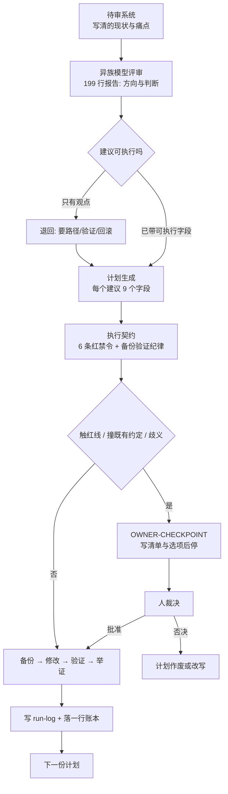

# 超四分之三的计划在现场被打补丁，为什么这恰恰证明无人值守流程跑通了

预期非交互 agent 会照单全收，实测 13 份计划在现场被打补丁，却全程零事故。我原以为把每步计划和代码写死就能消灭变数。结果偏差成了常态。读完你会把计划改造成暴露冲突的探针，并用硬契约划清自动修改与停手问人的边界。

## 一、同族自审只会顺着旧假设打转，异族评审挑出了裂缝却没法直接执行

让同族模型审查你的 agent 配置，多半只能得到“这套设计很扎实”的客套话。它和你共用同一批上下文，你的隐含假设会自动变成它的默认前提。你在配置里写“bot 必须有 goal”，它就会顺着你论证 goal 为什么重要。你漏掉的系统裂缝，它也会原样复刻并一起漏掉。

异族评审是指换用不同模型族做交叉审查，只认白纸黑字写下来的现状。这次实操里，Gemini 系负责评审，GLM 系跑被审系统，DeepSeek 系负责落地执行。三个模型族互不熟悉对方的顺手写法，因此“它居然这么理解”本身就是诊断信号。推断：跨模型族的理解差异能照出配置里的模糊地带。依据是不同模型族对未声明前提的默认补全方向不同。

当时我默认三个模型族比两个能多抓出配置漏洞，但这一假设没做过对照验证。如果两个模型族就够用，第一节“评审、被审、执行三族分立”的结论就不成立，落地执行直接复用评审模型族即可。想让异族模型挑出真问题，请求里得塞进含真实工作摩擦的 owner 画像与现存约束体系。痛点清单也要具体到“某类脚本会静默停摆”，并附上明确的输出契约：

```yaml
# 评审请求的输出契约（节选）
output:
  - 系统级诊断：哪些设计应坚持，哪些是过度设计或脆弱点
  - top_5: 问题 → 根因 → 具体改法（落到 config/skill/cron/流程层）→ 收益 → 风险
  - 专项: 稳定性 / 记忆体系 / owner 效率
  - pushback: 明确列出"不该动"的设计及理由
constraints:
  - 直接、具体、可执行；反对意见必须说
  - 简体中文；不写客套与空泛扩展
```

评审报告末尾专门有一节“不建议动的部分”，直接指出哪些地方属于过度设计、不值得改。但像“改为单源编译”这样的评审观点方向虽对，非交互 agent 拿在手里依然没法直接动工。

## 二、我以为把建议扩写成 10,866 行详尽计划，Agent 就能在现场照单全收

执行者动手前必须知道改哪两个文件、注入标记长什么样、写入要不要原子化。它还得知道改完跑什么命令验证，以及出错后怎么退回原状。我当时判断，只要把每条获批建议都扩写成带 9 个字段的自包含计划，agent 就能照单全收：

```text
1. 目标与验收标准（可验证的 DONE WHEN）
2. 影响面清单：每个新建/修改/删除文件的绝对路径 + 当前状态
3. 前置检查：动手前必须跑的只读命令
4. 备份步骤：具体命令与目标目录
5. 分步执行：每步给出具体内容/代码块/diff，关键脚本给完整可运行代码
6. 验证步骤：每项检查的命令与预期输出
7. 回滚方案：具体命令
8. 门禁级别 + OWNER-CHECKPOINT 标记
9. 失败隔离：哪步失败应中止，哪步失败可跳过并记录
```

第一轮异族评审产出的报告分为六个板块，一共只有 199 行。第二轮把观点扩成可执行计划后，四批文本吐出了 `2715 + 3487 + 2418 + 2246 = 10,866` 行。首批生成的 14 份计划把文本量撑大了 55 倍，单份平均达到 776 行。另外两项当时推迟讨论的建议，后来也单独补成了各 46 行的第 15、16 号计划。非交互 agent 在会话里只能看到单个计划文件和硬约束，我误以为把细节喂饱就能消灭现场变数。

我把这 16 份计划交给非交互 agent 串行跑完。任务从 `23:13:51` 持续到 `01:35:10`，总耗时 2 小时 21 分。执行账本共留下 34 行记录，首尾各有 1 条 `pre-backup` 备份与 `all-done` 收尾记录。中间是成对出现的 16 条 `start` 和 16 条 `end`，全部以退出码 0 结束：

| 结果 | 数量 |
|---|---|
| DONE（完全落地） | 13 |
| DONE-WITH-CHECKPOINT（阶段一落地，阶段二等裁决） | 2 |
| BLOCKED-WITH-CHECKPOINT（动手前就停） | 1 |

账本看着很完美。但 16 份执行报告里有 13 份写明了“与计划的偏差”。超过四分之三的计划在落盘时遇到阻碍，包括路径不对、脚本不可用或改造前快照已过期。把计划写到平均 776 行，根本没能让 agent 原样执行。

## 三、详尽计划的价值是逼出环境冲突，真正守住底线的是 27 行执行契约

即便把单份计划写到 776 行，里面附带的代码在真实环境面前也只能当草案看。第 2 号计划自带的反推脚本，把顶层分类目录和叶子技能名混进了同一个集合。那个脚本遍历时还不跟随符号链接，跑起来直接漏掉 90 个可用技能。执行者没有照抄这段有缺陷的代码，转而现场改成两层遍历并加上 CLI 快照断言。

验证步骤写得再细，到了现场也可能遇到退出码为 0 的假成功。第 1 号计划涉及的同步脚本，失败分支永远以退出码 0 结束，告警只走标准输出。如果照计划用退出码判定成败，所有同步失败都会被误判为成功。执行者读了脚本源码才改成抓日志尾部，可见账本里的 16 个 0 退出码只证明验证跑过且留了证据。

这正是复盘得出的真相：计划的价值不是被执行，而是把冲突提前暴露出来。写 10,866 行计划，是为了让执行者撞上环境差异时如实记下偏差、不顺手糊弄。推断：计划写得越细，越能提早暴露计划与真实环境的冲突。依据是计划写死了绝对路径与前置检查命令，环境不对就在动手前报错。

暴露冲突之后，让无人值守现场不失控的是一份 27 行的执行契约。口头叮嘱“别乱来”毫无用处。契约把不可逆与可逆操作拆成硬条目钉在最前面：

```markdown
## 绝对禁令（Red — 停下并报告）
1. 永不修改 agent 运行时本体源码；修复只落在 config / scripts / skills
2. 永不重启服务、不动 systemd、不 kill 进程、不执行自更新
3. 永不碰凭证、密钥、token、.env（只读引用可以）
4. 永不对外发布、发消息、代 owner 表态
5. 永不 force-push、不改写 git 历史、不删会话与记忆库
6. 永不未备份就删除或覆盖文件

## 必须遵守的纪律（Yellow — 备份 → 修改 → 验证 → 举证）
- 改动前备份到本任务 backups/<plan-name>/，保留相对路径
- 每个改动后跑计划里的验证命令，并把输出写进 run-log
- 标 OWNER-CHECKPOINT 的步骤：只准备清单/草稿，然后停
- 同一路径失败两次就换方案，不换壳重试同一假设
```

契约里还配套了一条现场最救命的冲突处理规则。当遇到文件不存在、路径不同或内容已改过时，执行者必须先在报告里记录偏差。随后它只能按计划意图保守落地，绝不能即兴发明破坏性的替代方案。整套从异族评审、计划扩写到契约兜底的流转关系如下：



## 四、用机械契约、可验证计划与现场硬停，划出无人值守改造的真实边界

触碰仓库既有契约或目标目录已变时，执行者不能保守落地，必须触发 `OWNER-CHECKPOINT` 硬停。全程 3 次硬停里有 1 次是真冲突拦截，出在第 7 号计划。第 7 号计划打算给每份来源材料算 SHA256 做去重。但目标仓库契约明文规定“内容哈希已于 2026-10-13 全仓退役，Git 即字节一致性层”，禁止重复算哈希。加上该计划照着旧目录编写，它要改的角色目录在同晚稍早的重构里已经消失。执行者列出 5 条带文件行号的冲突证据与 3 个可选方案及代价后停手。人只需回一个字母。

涉及大批量文件迁移或筛选时，契约同样规定只出清单、不动数据。另外 2 次硬停都属于这类迁移待批，其中一次领域合并生成了 81 个文件移动项。那次合并还跨及 74 个文件，一共整理出 132 处链接改写清单。另一次目录瘦身给出了 30 篇入口索引的候选，同样停下来等人确认。

如果前置检查直接证伪了计划的前提，计划就会在动手前被自己否决。有 1 份计划要给 1067 篇文档的目录瘦身，设定门槛是“正文短于 400 字 + 零入链 + 超过 120 天未改”。前置检查实测最短正文也有 479 个字符，三条规则全零命中。计划当场中止执行。

为了在事后核验所有计划是真跑通还是中途停手，执行账本采用纯文本追加记录。每次计划启动和结束时，都会往 `ledger.jsonl` 追加一行带时间戳与退出码的记录：

```json
{"ts":"2026-11-03T23:15:10+08:00","event":"start","plan":"plan-01"}
{"ts":"2026-11-03T23:20:53+08:00","event":"end","plan":"plan-01","exit":0}
```

跑完所有计划后，跑一段简短的 Python 脚本就能核对启动总数与异常退出数：

```python
import json
rows = [json.loads(l) for l in open("ledger.jsonl")]
start = sum(1 for r in rows if r["event"] == "start")
bad = sum(1 for r in rows if r["event"] == "end" and r.get("exit") != 0)
print(f"plans={start} nonzero_exit={bad}")
```

这套流程只是一套重型的安全底座改造工具，只保证每次改动都有备份、验证和回滚路径。跑完 16 份计划依然会出现硬停与前置否决，留下的 13 份偏差报告也还得靠人逐一审阅。推断：这套重型改造流程只在改系统基础设施时才划算。依据是四轮咨询与人工审阅偏差的成本都不低，适合改一次用几个月的底座，改单个定时任务纯属亏本。

日常拆分无人值守任务与编写规则时，直接按冲突能否被机械捕获来划定边界。**能被机械判定的，写进契约；需要判断但可验证的，写进计划；两者都不成立的，停下来问人。**

---

- **上文**：本文是「一张发给 Agent 的工牌」系列入口篇，从无人值守改造的第一道防线写起。
- **下文**：当同步脚本永远以退出码 0 结束时，如何防止定时任务静默停摆，见「失败在无人知晓处」系列。
- **旁支**：为什么靠纯文本账本与文件维持连续性，而不靠模型上下文记事，见「记忆不在上下文里」系列。
