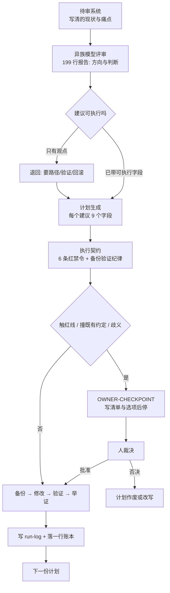

# 16 份计划里 13 份在现场打补丁：靠 27 行契约让异族模型的建议安全落地

无人值守 agent 落地的核心指标，是现场偏差捕获了多少。我通过四轮外部咨询攒出 16 份改进计划，交给非交互 agent 串行跑了 2 小时 21 分。现场有 13 份计划因环境差异打了补丁，但全程零事故，下面这套流程和契约可以直接照抄。

## 一、16 份计划里有 13 份在现场打补丁，为什么算成功？

执行账本完整记录了全自动落地的过程。这本账本共有 34 行记录，从 `23:13:51` 跑到 `01:35:10`，总耗时 2 小时 21 分。首尾各有 1 条记录，分别是开头的 `pre-backup` 备份和结尾的 `all-done` 收尾。中间是 16 个计划的成对记录，包含 16 条 `start` 和 16 条 `end`，且全部以退出码 0 结束：

| 结果 | 数量 |
|---|---|
| DONE（完全落地） | 13 |
| DONE-WITH-CHECKPOINT（阶段一落地，阶段二等裁决） | 2 |
| BLOCKED-WITH-CHECKPOINT（动手前就停） | 1 |

真正证明流程生效的，是 16 份执行报告里有 13 份写明了“与计划的偏差”。超过四分之三的计划在落盘时遇到阻碍，包括路径不对、脚本不可用或改造前快照已过期。写 10,866 行详尽计划不是为了让 agent 照单全收，而是为了让它如实记下偏差、不顺手糊弄。推断：计划写得越细，越能提早暴露计划与真实环境的冲突。依据是计划写死了绝对路径与前置检查命令，环境不对就在动手前报错。

## 二、同族自审只会顺着你的假设说，异族评审才能挑出裂缝

让同族模型审查你的 agent 配置，多半只能得到“这套设计很扎实”的客套话。它和你共用同一批上下文，你的隐含假设会自动变成它的默认前提。你在配置里写“bot 必须有 goal”，它就会顺着你论证 goal 为什么重要。你漏掉的系统裂缝，它也会原样复刻并一起漏掉。

异族评审不会继承你的上下文惯性，它只认你白纸黑字写下来的现状。这次实操的三个环节分给了三个模型族：Gemini 系做评审，GLM 系跑被审系统，DeepSeek 系负责执行。三个模型族互不熟悉对方的顺手写法，所以“它居然这么理解”本身就是诊断信号。推断：跨模型族的理解差异能照出配置里的模糊地带。依据是不同模型族对未声明前提的默认补全方向不同。至于三个模型族比两个能多抓多少漏洞，我没验证。

第一轮异族评审就产出了远超单次消化能力的 199 行报告。报告分六个板块，包含 Top 5 建议、三个专项和末尾一节“不建议动的部分”。这最后一节最值钱，因为它敢直接指出哪里属于过度设计、哪里不值得改。想让模型给出这种质量的反馈，prompt 里得放三样东西。一是含真实工作摩擦的 owner 画像。二是具体到“某类脚本会静默停摆”的痛点清单。三是现存约束体系：

```yaml
# 评审请求的输出契约（节选）
output:
  - 系统级诊断：哪些设计应坚持，哪些是过度设计或脆弱点
  - top_5: 问题 → 根因 → 具体改法（落到 config/skill/cron/流程层）→ 收益 → 风险
  - 专项: 稳定性 / 记忆体系 / owner 效率
  - pushback: 明确列出"不该动"的设计及理由
constraints:
  - 直接、具体、可执行；反对意见必须说
  - 简体中文；不写客套与空泛扩展
```

## 三、评审观点落不了地，必须扩写成自包含的执行计划

评审报告里一句“改为单源编译”方向很对，但还不是可执行的动作。执行者动手前必须知道改哪两个文件、注入标记长什么样、写入要不要原子化。它还得知道改完跑什么命令验证，以及出错后怎么退回原状。因此第二轮我要求模型为每条获批建议写出包含 9 个字段的自包含计划，缺一不可：

```text
1. 目标与验收标准（可验证的 DONE WHEN）
2. 影响面清单：每个新建/修改/删除文件的绝对路径 + 当前状态
3. 前置检查：动手前必须跑的只读命令
4. 备份步骤：具体命令与目标目录
5. 分步执行：每步给出具体内容/代码块/diff，关键脚本给完整可运行代码
6. 验证步骤：每项检查的命令与预期输出
7. 回滚方案：具体命令
8. 门禁级别 + OWNER-CHECKPOINT 标记
9. 失败隔离：哪步失败应中止，哪步失败可跳过并记录
```

把观点扩写成可执行计划后，文本量直接膨胀了 55 倍。这一轮分 4 批吐出了 `2715 + 3487 + 2418 + 2246 = 10,866` 行文本，14 份计划单份平均 776 行，而最初的评审报告只有 199 行。另外两项当时推迟讨论的建议，后来也单独补成了各 46 行的第 15、16 号计划。因为非交互 agent 在会话里只能看到一个计划文件和末尾硬约束，你省下的每一行都会变成它在现场的即兴发挥。

即便把单份计划写到 776 行，里面附带的代码也只能当草案看。第 2 号计划自带的反推脚本，把顶层分类目录和叶子技能名混进了同一个集合。那个脚本遍历时还不跟随符号链接，跑起来直接漏掉 90 个可用技能。执行者没有照抄这段有缺陷的代码，而是现场改成两层遍历并加上 CLI 快照断言。

## 四、无人值守不能靠模型自觉，得靠硬契约兜底

把计划交给自主 agent 顺序执行时，人是不在场的。口头叮嘱“别乱来”毫无用处，必须把安全边界写成可判定的硬条目。我用一份 27 行的执行契约，把“不可逆”和“可逆”操作分开钉在最前面：

```markdown
## 绝对禁令（Red — 停下并报告）
1. 永不修改 agent 运行时本体源码；修复只落在 config / scripts / skills
2. 永不重启服务、不动 systemd、不 kill 进程、不执行自更新
3. 永不碰凭证、密钥、token、.env（只读引用可以）
4. 永不对外发布、发消息、代 owner 表态
5. 永不 force-push、不改写 git 历史、不删会话与记忆库
6. 永不未备份就删除或覆盖文件

## 必须遵守的纪律（Yellow — 备份 → 修改 → 验证 → 举证）
- 改动前备份到本任务 backups/<plan-name>/，保留相对路径
- 每个改动后跑计划里的验证命令，并把输出写进 run-log
- 标 OWNER-CHECKPOINT 的步骤：只准备清单/草稿，然后停
- 同一路径失败两次就换方案，不换壳重试同一假设
```

契约里还藏着一条现场最救命的冲突处理规则。当现实与计划冲突，比如文件不存在、路径不同或已经改过时，执行者必须先记录偏差。随后它只能按计划的意图保守落地，绝不能即兴发明破坏性的替代方案。整套从评审、计划到契约执行的流转关系如下：



## 五、现场硬停、前置否决与假成功，划出了自动化的真实边界

触碰仓库既有契约或目录已变时，执行者必须立刻硬停。3 次硬停里有 1 次是真拦截，出在第 7 号计划。它要给每份来源材料算 SHA256 做去重，但目标仓库契约明写着“内容哈希已于 2026-10-13 全仓退役，Git 即字节一致性层”。而且第 7 号计划照着旧目录编写，它要改的角色目录在同晚稍早的重构里已经消失。执行者列出 5 条带文件行号的冲突证据、3 个可选方案及各自代价后停手，人只需回一个字母。

涉及大批量文件迁移或筛选时，执行者只出清单、不动数据。另外 2 次硬停都属于这类迁移待批，其中一次领域合并生成了 81 个移动、74 个文件里 132 处链接改写的清单。另一次目录瘦身给出了 30 篇入口索引的候选，同样停下来等人确认。还有 1 份计划要给 1067 篇的目录瘦身，门槛是“正文短于 400 字 + 零入链 + 超过 120 天未改”。实测最短正文也有 479 字符，三条全零命中，计划被自己的前置检查否决。

退出码为 0 不代表业务真的成功，验证步骤必须看真实日志。第 1 号计划涉及的同步脚本，失败分支永远以退出码 0 结束，告警只走标准输出。如果照计划用退出码判定成败，所有同步失败都会被误判为成功。执行者读了脚本源码才改成抓日志尾部，所以账本里 16 个 0 退出码只证明“跑完了、验证命令执行过、证据写下来了”。

这套流程不是全自动免检金牌，而是一套重型的安全底座改造工具。它只保证每次改动都有备份、验证和回滚路径。16 份计划里依然有 3 次硬停、1 次前置检查否决，还有 13 份偏差报告要人读。推断：这套攒出 10,866 行计划、串行跑 2 小时 21 分的流程，只在改基础设施时才划算。依据是四轮咨询和人工审阅读偏差的成本都不低。它适合“改一次要活几个月”的系统底座，拿去改单个定时任务纯属亏本。

## 六、复现这套流程，只需要拿走最小骨架与判定式

在自己的仓库里复现这套流程，只需要保留四件核心组件。这四件组件环环相扣，缺一件就会退回“AI 帮我看了看”的水平。你可以直接照着下面这份四件套清单搭起最小骨架：

1. **评审请求**带输出契约：要异族模型给判断、给反对意见、给可落地到配置层的改法。
2. **计划**固定 9 个字段：DONE WHEN、影响面、前置检查、备份、分步（含完整代码）、验证、回滚、门禁与 checkpoint、失败隔离。
3. **执行契约**写清红黄线：6 条红禁令 + 备份验证纪律 + “冲突时按意图保守落地、记录偏差”。
4. **账本**配齐双记录：一个计划一次 `start`、一次 `end`，一行 JSON，外加一份写清偏差的 `run-log`。

执行账本不需要引入复杂的外部存储，纯文本追加最可靠。每次计划启动和结束时，往文件里追加一行带时间戳与退出码的记录即可。实际使用的两行账本格式如下：

```json
{"ts":"2026-11-03T23:15:10+08:00","event":"start","plan":"plan-01"}
{"ts":"2026-11-03T23:20:53+08:00","event":"end","plan":"plan-01","exit":0}
```

跑完所有计划后，用三行 Python 核心逻辑就能自动完成账本验收。脚本会直接扫一遍 `ledger.jsonl`，核对启动总数和异常退出数。验收时直接跑这段脚本：

```python
import json
rows = [json.loads(l) for l in open("ledger.jsonl")]
start = sum(1 for r in rows if r["event"] == "start")
bad = sum(1 for r in rows if r["event"] == "end" and r.get("exit") != 0)
print(f"plans={start} nonzero_exit={bad}")
```

把异族模型没受原有假设污染的诊断变成安全改动，靠的是 27 行契约、34 行账本和 3 次硬停。日常拆分任务与编写规则时，直接套用下面这条判定式即可。**能被机械判定的，写进契约；需要判断但可验证的，写进计划；两者都不成立的，停下来问人。**
