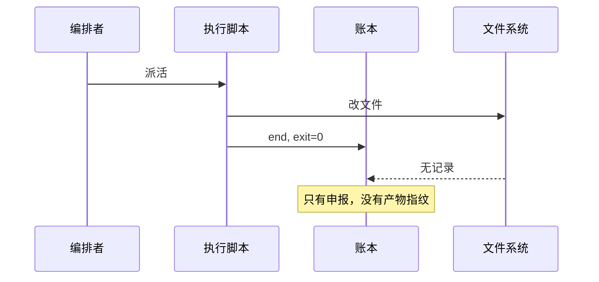

## 账本是什么、给谁看

执行账本（Execution Ledger，EL）是无人值守任务里按时间追加的事件记录文件，给事后核查的人和编排脚本看，回答三个问题：跑了什么、停在哪里、改出了什么。定时任务只读文件时，丢一次运行顶多缺一份日报；任务开始在无人值守时改文件之后，写坏的工作区会直接污染下一次运行的输入。所以我们需要一份独立于终端滚动输出的记录，没人盯着屏幕的时候也能留下可核对的凭据。

账本和运行日志的用途从一开始就不同。运行日志用来排障，保留命令的标准输出（stdout）和过程细节；EL 用来验收，每一行都应该是一条结构化断言，脚本不读全文就能判定成败。两者混在一起，就会拿日志的长度当验收的证据。

我们手头这本真实的 EL 来自一次批量计划执行，一共三十几条记录，按固定顺序写入：开头是备份动作，中间是各个计划成对的事件，末尾是一条收尾标记。它看上去结构整齐、首尾对得上，编排脚本扫一眼末行就能宣布收工。问题就出在这份整齐上：它记的全是执行者自己报上来的动作名，只有申报，没有一行指向工作区里的真实变更。

## 一条记录里有什么

这本 EL 由四种事件组成：打头的 pre-backup，中间成对出现的 start 和 end，收尾的 all-done。所有行都用同一套精简的键名，字段只有 `ts`、`event`、`plan`、`exit`，唯一的例外是打头那条 pre-backup，只有它带了 `rc` 字段。下面是其中一条真实的完成记录：

```json
{"ts":"2026-11-03T23:20:53+08:00","event":"end","plan":"plan-01","exit":0}
```

这四个字段能证明的事很有限。`ts` 说明某个进程在那个时刻调了一次写文件接口；`event` 和 `plan` 说明它自称在处理哪一份计划；`exit` 为 0 说明子进程结束时向操作系统交回了零。整本账本里没有一条记录带 status、result、state 这类表示业务结果的字段。

看到 `exit: 0`，很容易直接把它当成「计划已按预期改好文件」。这样省掉了核对工作区的工夫，在只读任务里也勉强够用。可任务一旦要改文件，进程跑完和改动生效之间就隔着好几个可能静默失败的环节。把退出码直接当业务结论，等于默认脚本里的每一条分支都守着「失败就返回非零」的约定。

## 账面全绿，报告里有阻塞

把账本和同一次运行的现场记录放在一起对，差别马上就出来了。账本里 16 条 end 记录的 `exit` 全是 0，末行还写着 all-done，只看账本的人会以为所有计划都顺利落地。可同一次运行的 run-logs 里，有三份（plan-06、plan-07、plan-15）明确写着 BLOCKED；配套的计划总结里，16 份有 13 份写了 deviation 或「偏差」。

账面全绿、报告里却有阻塞和偏差，第 1 号计划总结的第 4.2 节写得很直白：

> `sync_fail()` … always `exit 0`（stdout is the alert, by design）

写脚本的人故意让失败函数返回 0，指望别人去读 stdout 里的告警文字。账本采集器只收退出码，这些告警就全漏掉了。

所以单靠退出码验收是靠不住的。「账面全成功、报告里有阻塞」能同时成立，多半是因为账本和 run-logs 的来源不同：账本只从进程退出状态取值，BLOCKED 和 deviation 只写进了文本报告。只要两边各写各的、互不校验，账本就会一直报成功，真正的阻塞留在没人自动解析的文字里。

## 退出码由进程自己决定

POSIX 把退出状态定义成进程自己返回的整数，任何进程都能返回 0。内核只负责把这个整数从子进程搬给父进程，不检查磁盘有没有写成功，也不管业务目标有没有达成。脚本末尾写死一句返回零，哪怕前面一步都没干，父进程拿到的照样是成功。

第二处问题是读写同源。干活的脚本和写账本的动作往往在同一条执行链上，文件系统本身不会绕过脚本给账本送一份独立的凭据，下图里文件系统到账本那一路是空的：



工作区改没改，只有文件系统知道；账本上写什么，却由执行脚本或只看退出码的包装器决定。干活的和填表的共用同一条进程返回路径，账本记下的就只是当事人自己的申报。只记 exit 的账本，越自动越容易变成摆设：无人值守的链路越长，人越依赖末行汇总，而 `exit 0` 正好能掩盖所有按设计吞掉的错误。

这一节的结论有一个没验证的前提：编排器至少能拿到子进程真实的退出码。如果外层编排器只捕获 stdout 文本，或者通过管道调用把退出码吞了，又或者干脆让模型在文本里自报完成，上面关于退出码传递的分析就不成立，问题会提前到输出解析那一层。

## 完成记录要补的字段

要让 EL 从申报表变成证据链，同一条完成记录里要放进执行者没法随手编造的外部指纹。原来的四个字段只交代了时间、动作名、计划名和退出码，全是进程自己说了算的内部状态。这四个字段留着当索引，但不再当验收依据；验收字段要指向工作区在执行前后的实际变化，让核查脚本拿到记录就能去磁盘上对账。

要补的有三组。第一组是目标文件改动前后的内容摘要和路径清单：编排器派活前对目标路径算一次哈希，收到 end 事件时再算一次，前后两组值写进同一条记录。第二组是独立于退出码、机器可读的状态字段，比如从约定结构里提取的 status 或 state，用来区分正常完成、带偏差完成和阻塞。第三组是对应 run-log 的文件路径和字节大小，防止日志没落盘却报了成功。

这些字段由外层编排器在子进程退出后自己采集、自己写入，不交给干活的脚本填，进程自己报的不算。如果还让 `sync_fail()` 所在的脚本去写 status 字段，它照样能把 BLOCKED 写成成功。当然，产物指纹也只能证明文件确实变成了某个哈希，证明不了改出来的内容在业务上是对的。把「改没改」和「改得对不对」分开，账本先管住「改没改」。

## 申报和事实冲突时两边都记

字段补齐之后，只要干活的脚本还在跑，申报和事实迟早会冲突。最常见的就是前面那种：子进程交回 `exit: 0`，配套的日志或状态文件里却写着 BLOCKED。另一种是工作区的前后哈希没有变化。旧账本只信退出码，冲突进不了账本。新账本遇到不一致，先把冲突双方都记进同一条记录，写入时不替任何一方美化。

`exit` 为 0、解析出的业务状态是 BLOCKED 时，这条 end 记录照实保留 `exit: 0`，同时在状态字段写明阻塞，后面附上触发阻塞的日志位置。退出码报成功、本该改的文件哈希却没变时，记录里同时留下相同的首尾哈希和零退出码。这样下游脚本扫到这条记录，不用去翻别的目录，单看这一行内部的前后矛盾就能拦住后续流程。

冲突照实记下之后，账本末尾那条笼统的 all-done 也该去掉了。以前只要账面上没有非零退出码，末行就记成全部完成；现在汇总行按状态字段分类计数，正常完成、带偏差、阻塞各记一个数。这三类不拆开，汇总行就还是只在数退出码。

## 不需要这本账本的场景

产物指纹、状态提取、冲突并记都加上，每跑一个计划要多出两次哈希计算和一次日志扫描。无人值守改文件时，这笔开销值得花；放到别的场景，可能就是累赘。上不上这套机制，先看任务的读写属性和失败代价。

纯只读的巡检任务用不着这种重型账本。脚本只是拉一下接口状态、算几个指标发到群里，就算某次静默失败，工作区里也没有文件被改坏，看一眼消息有没有按时到就够了。人在回路里的交互式会话也用不着：我们坐在终端前看着模型一步步改代码、随时准备按停止键，屏幕上的差异对比就是最直接的证据，没必要再旁路写一份带指纹的 EL。

底层存储或工具链自带原子提交和预写式日志（Write-Ahead Logging，WAL）时，也不该自己再造账本。如果每一步改动都直接落成带签名的版本库提交，或者写进支持事务回滚的数据库，存储引擎自己的日志已经记下了前后状态和校验值。在外面再套一层只记文件哈希的 JSON 行文件，只会多出维护负担，不会多出确定性。只有脚本直接改工作区文件、又没人盯着它跑的时候，才需要这本带产物指纹的账本。

## 参考与延伸

- [POSIX 退出状态规范](https://pubs.opengroup.org/onlinepubs/9699919799/utilities/V3_chap02.html)
- [SQLite 预写式日志文档](https://www.sqlite.org/wal.html)

---

- 上文：[无人值守时那条「什么时候该停」的线是怎么写出来的](/notes/heterogeneous-agent-audit/)
- 下文：[修完一周后，越界从文件挪到了字段](/notes/agent-wrote-outside-its-surface/)，账本对上产物之后验收还会漏什么：回执说只动两个字段，diff 里躺着五个。
- 旁支：[模型没变慢，它不说话了](/notes/the-model-stopped-talking/)，同样是把自报的数字当事实，这次发生在延迟测量上：按调用计的曲线平了两周，换了分母才对上账。
