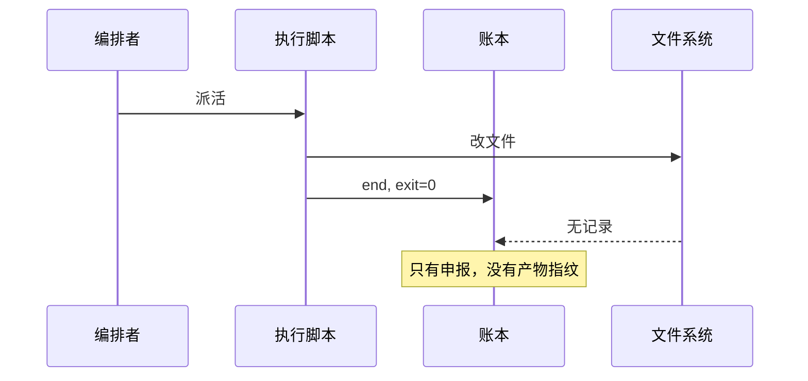

## 账本是什么、给谁看

执行账本（Execution Ledger，EL）是无人值守任务里按时间追加的事件记录文件。它服务于事后核查的人和编排脚本，用来回答「跑了什么、停在哪里、改出了什么」三个问题。定时任务只读文件时，丢一次运行顶多缺一份日报。任务开始无人值守改文件之后，写坏的工作区会直接污染下一次运行的输入。我们需要一份独立于终端滚动输出的记录，在没人盯着屏幕的时候留下可核对的凭据。

账本跟运行日志的职责从一开始就不同。运行日志面向排障，保留命令的标准输出（Standard Output，stdout）和过程细节。EL 面向验收，每一行都应该是一条结构化断言，供脚本在不读全文的前提下判定成败。混淆这两者，我们就会拿日志的长度代替验收的证据。分清两者的受众，才能看懂一本真实账本里到底写了什么、漏了什么。

那本账本只记了申报。

我们手头这本真实的 EL 来自一次批量计划执行，全篇一共三十几条记录。它按固定顺序写入：开头是备份动作，中间是各个计划的成对事件，末尾是一条收尾标记。表面上看，这本账本结构整齐、首尾呼应，编排脚本扫一眼末行就能宣布收工。问题恰恰出在这份整齐上：它记录的全是执行者自己报上来的动作名称，没有一行指向工作区里的真实变更。

## 一条记录里有什么

拆开这本 EL，整份文件由四种事件拼成。打头是 pre-backup，中间是成对出现的 start 和 end，收尾是一条 all-done。所有行都用同一套精简的键名，字段只有 `ts`、`event`、`plan`、`exit`。唯一的例外是打头的 pre-backup，只有那一条记录里出现了 `rc` 字段。下面是那本账本里一条真实的完成记录：

```json
{"ts":"2026-11-03T23:20:53+08:00","event":"end","plan":"plan-01","exit":0}
```

这四个字段能证明的事情非常有限。`ts` 说明某个进程在那个时刻调了一次写文件接口。`event` 和 `plan` 说明它自称正在处理哪一份计划。`exit` 为 0 说明子进程结束时向操作系统交回了零值。整本账本没有任何一条记录带 status、result、state 这类表达业务结果的字段。

看到 `exit: 0` 的时候，我们很容易把它直接等同于「计划已按预期改好文件」。这种跳跃省掉了核对工作区的力气，在只读任务里也勉强够用。一旦任务要落地改文件，进程跑完和改动生效之间就隔着好几道可能静默失败的关卡。把退出码直接当成业务结论，等于默认脚本里的每一条分支都严格遵守了失败即非零的约定。

## 申报与事实的裂缝

账本上的数字与运行现场的记录放在一起，裂缝立刻就露出来了。那本账本里 16 条 end 记录的 `exit` 全是 0，末行还写着 all-done。只看账本的人会得出全部计划顺利落地的结论。翻开同一次运行的 run-logs，里面有三份（plan-06、plan-07、plan-15）明确写着 BLOCKED。再去翻配套的计划总结，16 份总结里有 13 份写了 deviation 或「偏差」。

为什么账面上全绿，文本报告里却躺着阻塞和偏差？第 1 号计划的总结第 4.2 节写得很直白：

> `sync_fail()` … always `exit 0`（stdout is the alert, by design）

写脚本的人故意让失败函数返回 0，指望别人去读 stdout 里的告警文字。账本采集器只管收退出码，自然把告警全漏掉了。

这种裂缝暴露了单靠退出码验收的脆弱性。推断：账本与 run-logs 的落点不同源，才让「账面全成功、报告里有阻塞」同时成立。依据是账本只从进程退出状态取值，而 BLOCKED 与 deviation 只写进了文本报告。只要两边各写各的、互不校验，账本就会一直报喜，把真正的阻塞留在没人自动解析的文字堆里。

## 裂缝从哪来

退出码之所以不可信，根源在机制本身。POSIX 把退出状态定义成进程自己返回的整数，内核只负责搬运。任何进程都能返回 0。内核只负责把这个整数从子进程搬给父进程，既不检查磁盘有没有写成功，也不关心业务目标有没有达成。只要脚本末尾写死一句返回零，哪怕前面一步都没干，父进程拿到的照样是成功信号。

更深一层的问题在于读写权限的同源。如下图所示，干活的脚本和写账本的动作往往绑在同一条执行链上，文件系统本身并不会越过脚本向账本投递独立凭据：



工作区到底改没改，只有文件系统知道；账本上怎么写，却由执行脚本或只看退出码的包装器决定。当「干活的人」和「填表的人」共用同一个进程返回路径，账本记下的就只是当事人的口头申报。推断：只记 exit 的账本，越自动越容易变成装饰。依据是无人值守链路越长，人越依赖末行汇总，而 `exit 0` 恰好能掩盖所有按设计吞掉的错误。

这里必须指认一处未验证的假设：本节结论建立在「编排器至少能拿到子进程真实退出码」之上。如果外层编排器只捕获 stdout 文本、通过管道调用导致退出码被吞，或者干脆让模型在文本里自报完成，情况就会不同。这时本节关于退出码传递链的分析就不成立，裂缝会直接前移到输出解析层。

## 一条记录该有哪些字段

要让 EL 从「申报表」变成「证据链」，同一条完成记录里必须塞进执行者无法随手编造的外部指纹。原来的四个字段只交代了时间、动作名、计划名和退出码，全都是进程自己说了算的内部状态。我们保留这四个字段作为索引，但不能再让它们充当验收依据。真正的验收字段必须指向工作区在执行前后的物理变化，让核查脚本拿到记录就能去磁盘上对账。

第一组要补的是目标文件在改动前后的内容摘要与路径清单。编排器在派活前先对目标路径算一次哈希，在收到 end 事件时再算一次哈希，把前后两组值同时写进这条记录。第二组要补的是独立于退出码的机器可读状态字段，比如从约定结构里提取的 status 或 state。这个字段用来明确区分正常完成、带偏差完成和阻塞。第三组是对应的 run-log 文件路径与字节大小，防止日志根本没落盘却报了成功。

这些新增字段必须由外层编排器在子进程退出后亲自采集并写入，不能交由干活的脚本自己填报。如果还是让 `sync_fail()` 所在的脚本去写 status 字段，它照样能把 BLOCKED 写成成功。当然，加上产物指纹也只能证明文件确实按某个哈希变了，不能证明改出来的内容在业务语义上绝对正确。把「改没改」跟「改得对不对」拆开，账本先把「改没改」管住。

进程自己报的不算。

## 冲突时账本该记什么

补齐字段之后，只要干活的脚本还在跑，申报与事实就迟早会发生冲突。最常见的冲突就是前面见过的场景：子进程交回了 `exit: 0`，但配套的日志或状态文件里写着 BLOCKED。另一种情况是工作区的前后哈希根本没有变化。旧账本的做法是只信退出码，把冲突挡在账本门外。新账本在遇到不一致时，首要原则是把冲突双方同时记进同一条记录，绝不在写入时替任何一方做美化。

当 `exit` 为 0 而解析出的业务状态为 BLOCKED 时，这条 end 记录应当如实保留 `exit: 0`。同时还要在状态字段写明阻塞，并把触发阻塞的日志位置附在后面。当退出码报成功、预期要改的文件哈希却纹丝不动时，记录里就要同时留存相同的首尾哈希与零退出码。这样一来，任何下游脚本扫到这条记录，不用去翻其它目录，单凭这一行内部的前后矛盾就能立刻拦住后续流程。

把冲突原样记下之后，整本账本末尾那条粗暴的 all-done 事件也就该退场了。以前只要账面上没有非零退出码，末行就盖上全数完成的戳。现在汇总行必须按状态字段分类计数，把正常完成、带偏差、阻塞的计划拆成明确的账目。如果连这三类数字都不拆开，还要这本账本干什么？

## 什么时候不需要账本

给账本加上产物指纹、状态提取和冲突并记，每跑一个计划都要多出两次哈希计算和一次日志扫描。这套开销在无人值守改文件的场景下是保命钱，放到别的场景里可能就是纯粹的累赘。决定上不上这套机制之前，我们先得看清任务的读写属性和失败代价。

纯只读的巡检任务不需要这种重型账本。脚本只是去拉一下接口状态、算几个指标发到群里。就算某次静默失败，工作区里没有任何文件被改坏，看一眼消息有没有按时到达就够了。人在回路里的交互式会话也不需要它。当我们坐在终端前面看着模型一步步改代码、随时准备按停止键的时候，屏幕上的差异对比就是最直接的证据。这时没必要再旁路写一份带指纹的 EL。

底层存储或工具链自带原子提交与预写式日志（Write-Ahead Logging，WAL）时，也不该自己造账本。如果每一步改动都直接落成带签名的版本库提交，或者写在支持事务回滚的数据库里，存储引擎已经替你记了。存储引擎自己的日志就已经记录了前后状态与校验值。我们在外面再套一层只记文件哈希的 JSON 行文件，除了增加维护负担，不会提供更多确定性。只有当脚本直接裸改工作区文件、又没人盯着它跑的时候，这本带产物指纹的账本才是不可替代的底线。

## 参考与延伸

- [POSIX 退出状态规范](https://pubs.opengroup.org/onlinepubs/9699919799/utilities/V3_chap02.html)
- [SQLite 预写式日志文档](https://www.sqlite.org/wal.html)
- [Wikipedia 预写式日志词条](https://en.wikipedia.org/wiki/Write-ahead_logging)

---

- 上文：[无人值守时那条「什么时候该停」的线是怎么写出来的](/notes/heterogeneous-agent-audit/)
