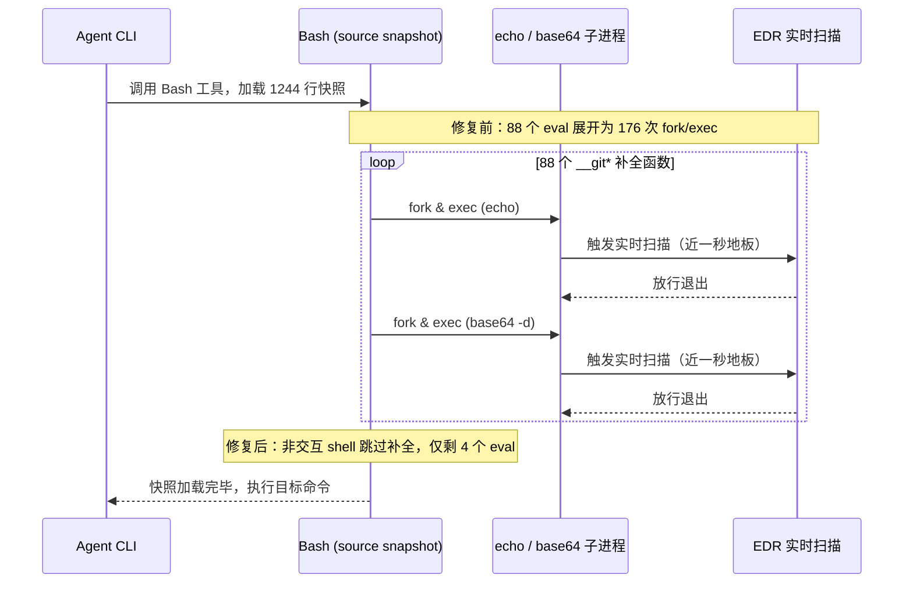

> 「差距不在模型之间」系列第一篇：同一个模型换一套 harness 与机器，表现能差出一个世代。

## 任务管理器里数字最大的进程

「Claude 最近两天怎么这么卡。」听到这句抱怨，我先去查了它的版本记录，这两天连着更新了四次二进制。接着我又怀疑网络，因为本机所有请求都要绕过本地代理 `ghc-proxy`。两边都没找到证据，我打开任务管理器，盯上了排在最前、数字最大的 `nmem-server`，直到看到这样一句话：

> 它跑了几个月都这样，我不认为是根因。

我这才意识到前两次方向都错了：一个常量再大，也解释不了一个变量。要找的是最近两天变了的东西，不是数字最大的东西，而我两次都是先有结论，再去找证据。既然每次交互都要等，那就直接去量每次工具调用之前要做的事。

Claude Code 每次执行 Bash 工具前，都会先加载一份快照（shell snapshot），量它的加载时间用这条命令：`latest=$(ls -t ~/.claude/shell-snapshots/*.sh | head -1); time bash -c "source \"$latest\""`。第一次跑了 58,722 ms，紧接着再跑一次，直接卡到两分钟超时。这份快照有 1244 行，`grep -c 'base64 -d'` 数出 88 处，每处都是一行 `eval "$(echo '<base64>' | base64 -d)"`，解出来是 Git-for-Windows 的 git 补全函数。

每个 eval 的管道要 fork 两次（`echo` 一次、`base64` 一次），所以每次工具调用之前要创建 176 次进程。我单拿出一条 eval 测了三回，每回都在一两秒上下。单次 eval 已经到了秒级，176 次 fork 加起来，和将近一分钟的总耗时大致对得上。

## 地板有多高

解码一段很短的字符串，为什么要一两秒？我跑了一回 `/usr/bin/true`，这个程序什么都不做，启动后立刻退出，实测 894 ms。也就是说在这台机器上，光是创建一个进程就要将近一秒，下面把它叫作地板。拿这个地板去看平时觉得慢的几个工具，耗时都落在它附近：

| 探针命令 | 实测量级 | 实际工作 |
| :--- | :--- | :--- |
| `/usr/bin/true` | 近一秒 | 立刻退出 |
| `where.exe` | 近一秒 | 空跑查找 |
| `git --version` | 近一秒 | 打印版本号 |
| `pwsh -NoProfile -Command 'exit 0'` | 两秒出头 | 启动空壳退出 |

只打印版本号的 `mise --version` 也要两秒多。空跑 `/usr/bin/true` 就要近一秒，所以 mise 慢多半是地板叠加的结果，不是它自己的解析开销：它只是在这个地板上叠了百来兆的二进制、四十多个工具的解析和外层的 scoop shim。

地板这么高，是因为企业统一下发的终端防护（endpoint detection and response，EDR）。实时监控、行为监控、下载扫描、访问时扫描四个开关全开，每次 exec 都要过一遍实时扫描，大的二进制扫得更久。之前跑 `du -sh ~/.claude/*` 超时两分钟也是这个原因：目录里有八百多个技能说明文件，每个 stat 都要过一遍扫描。我想看一眼排除列表，终端返回的是 `N/A: Must be an administrator to view exclusions`。

没有管理员权限，单个进程的启动成本降不下来，能改的只有每次调用里创建进程的次数。下图是一次工具调用的过程：先 source 快照，88 个 eval 展开成 176 次 fork，每次 exec 都要过一遍实时扫描。

## git-prompt.sh 漏掉的交互判断

给人敲命令用的 git 补全函数，为什么会出现在非交互的工具调用里？顺着 Git for Windows 的启动链往回找，问题在 [Git for Windows 打包脚本里的 `git-prompt.sh`](https://github.com/git-for-windows/git-sdk-64/blob/main/etc/profile.d/git-prompt.sh) 第 8 行开始的那个分支：如果用户目录下有 `~/.config/git/git-prompt.sh`，就加载这个用户脚本，否则走默认的 `else` 分支。原脚本并不是无条件加载补全的。

`else` 分支里的条件是 `test -n "$BASH_VERSION" && test -z "$WINELOADERNOEXEC"`，也就是「非 Wine 的 bash」并且补全文件存在，才去 source `git-completion.bash` 和 `git-prompt.sh`。它没有判断当前是不是交互式 shell。我跑了一组对照：`bash -c 'declare -F | grep -c "__git"'` 得到 0，换成带 `-l` 的 `bash -lc`，得到 84 个 `__git*` 函数。

加不加 `-l` 差出 0 和 84，所以快照里的 84 个 `__git*` 函数多半来自登录 shell（login shell）加载的 `profile.d`。这要以「Claude Code 用 login shell 生成快照」为前提，这一点我没有官方依据：手头只有快照里出现了 `bash -lc` 才有的函数，而[社区 issue 的调试日志](https://github.com/anthropics/claude-code/issues/19585)只显示它去找 `.bashrc`。这个前提影响的是补全怎么被固化进快照，不影响前面量出来的耗时。

修法不用动系统目录：在 `~/.config/git/git-prompt.sh` 写一个文件接管那个 `else` 分支，用 `case $- in *i*)` 检查 shell 标志。交互式 shell 的 [`$-` 里会有 `i`](https://www.gnu.org/software/bash/manual/html_node/Is-this-Shell-Interactive_003f.html)，这个判断在内存里完成，不 fork 也不读文件，只有带 `i` 时才加载补全。改完重跑对照，`bash -lc` 回到 0，日常敲命令用的 `bash -ilc` 照样拿到 84 个函数。

改完之后的快照从 1244 行缩到 168 行，原来的 88 个 eval 只剩 4 个自定义函数。加载耗时从 58,722 ms 降到 2,747 ms，快了 21 倍，平时终端里的 Tab 补全也没受影响。

## 后台孤儿进程与两层地板

按少启动进程的思路再查一圈：状态栏每次刷新要三点八秒；SessionStart hook 到第 10 行才写 `if ($env:PANEL_ENV -ne "1") { exit 0 }`，而这个变量没设，七秒钟全花在启动一个 `pwsh` 再立刻退出上。把条件挪到 `pwsh` 前面，改成 `[ "${PANEL_ENV:-}" = "1" ] && [ -n "${PANEL_ID:-}" ] || exit 0; exec pwsh ...` 短路掉，七秒变成了半秒。

更大的一笔在后台进程表里。二十几个 `find.exe` 在跑 `find / -maxdepth 6 -type d -name openai -path *packages*`，在 git-bash 里 `/` 映射整个系统盘。这些进程的父进程早就没了，没人回收，一共占着五个多核。我先用 PowerShell 的 `Stop-Process` 去清，命令报成功，进程数却没变。

再杀一次，报错 `FAILED : Cannot find a process with the process identifier 9764.`，进程卡在退出状态清不掉。这批是 MSYS 进程，Windows 侧的 PID 和 MSYS 的 PID 本来就不是一回事。切回 git-bash 跑 `ps -W | grep 'find\.exe' | awk '{print $1}' | while read -r p; do kill -9 "$p"; done`，二十几个孤儿才全部清掉，空闲内存从十几 GB 回到二十六 GB。清完之后我又测了一回 `/usr/bin/true`，降到了约 350 ms。

所以地板有两层。从近九百毫秒降到三百多毫秒，这段差值多半来自 CPU 争抢：那批孤儿占着五个多核，清掉之后重测马上回落。EDR 那一层是机器给的硬限制，孤儿争抢 CPU 这一层是我自己造成的。只靠 deny 规则堵 `find /`，换个写法就漏过去了，也拦不住在循环里大量 fork 的脚本。

我把这台机器上的实际代价写进了全局 `CLAUDE.md`，让 agent 自己算账：
`Never root a find at /, //, or a drive root. In git-bash / maps to the whole system drive; such a scan runs for hours, survives the parent shell as an orphan, and no one reaps it.`
`Process spawn on this host costs ~0.9 s even for a no-op binary, so a loop that shells out per item is far more expensive than it looks. Prefer one command that handles the whole batch over N invocations.`

这些修补不需要管理员权限，代价是每换一台受管机器，钩子和规则都要重新配一遍。接管 `else` 分支的这个覆盖点只在 Git for Windows 的 git-bash 里有效，换别的终端要另找钩子。三百多毫秒的进程启动底噪也还在。要根治，还是得请 IT 把开发工具目录加进终端防护的排除列表，到那时变快的也不止一个 CLI。

---

- 上文：这篇文章是该系列的第一篇。它要回答的问题是：你怀疑模型变慢的时候，先量本机的进程创建基线，能少走多少弯路。
- 下文：[模型没变慢，它不说话了](/notes/the-model-stopped-talking/)，同一系列第二篇：进程启动的地板量清之后，按回合重算延迟，才看到一半以上的响应里一个字的正文都没有。
- 旁支：[账本只能证明有人申报过](/notes/ledger-only-proves-a-claim/)，另一种被表面信号带偏的情形：账本里的 `exit 0` 只证明有人申报过成功，验收要看产物指纹。
