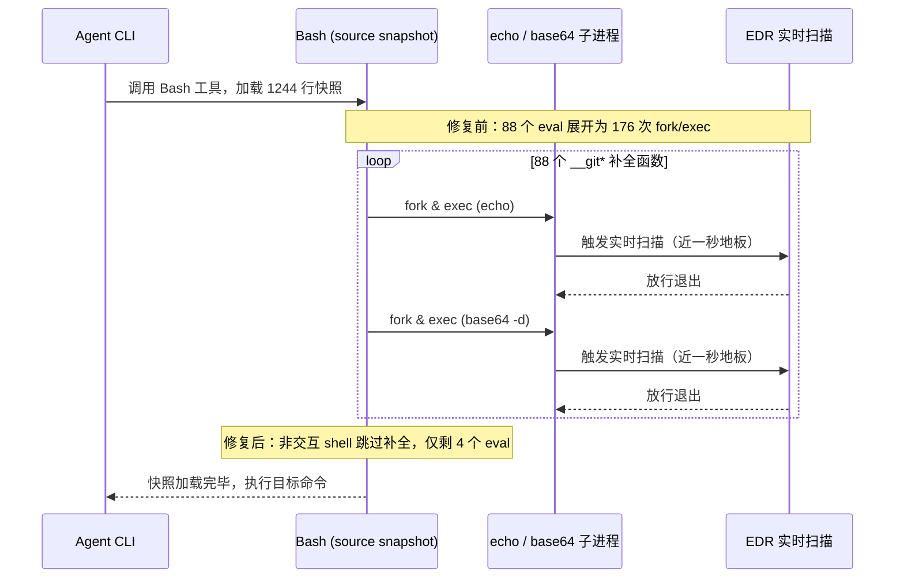

> 「差距不在模型之间」系列第一篇：同一个模型换一套 harness 与机器，表现能差出一个世代。

## 打开任务管理器，被一句原话按住

「Claude 最近两天怎么这么卡。」听到这句抱怨，我先去查了它的版本记录，发现这两天连着更新了四次二进制。接着我又去怀疑网络，因为本机所有请求都要绕过本地代理 `ghc-proxy`。两边都没抓到实锤，我打开任务管理器，盯住了排行榜上数字最大的 `nmem-server`。直到一句原话把我按住：

> 它跑了几个月都这样，我不认为是根因。

方向全错了。

我这才反应过来自己犯了方法论错误——一个常量再大也解释不了一个变量。我们要找的是「最近两天变化了的」，不是「数字最大的」。两次都是先有结论，再去找证据。既然每次交互都在等，那就直接量工具调用的前置动作。

Claude Code 每次执行 Bash 工具前，都会先加载一份内容快照（shell snapshot）：`latest=$(ls -t ~/.claude/shell-snapshots/*.sh | head -1); time bash -c "source \"$latest\""`。这一跑直接花掉 58,722 ms，紧接着再跑第二次，干脆卡满两分钟超时。拆开这份 1244 行的快照，`grep -c 'base64 -d'` 数出来整整 88 处。每一行都是 `eval "$(echo '<base64>' | base64 -d)"`，里面塞满了 Git-for-Windows 的 git 补全函数。

每个 eval 在管道里要 fork 两次（`echo` 一次、`base64` 一次）。算下来，单次调用前足足触发了 176 次进程创建。我单拎出一条 eval 测了三回，耗时都在一两秒上下。推断：176 次 fork 与将近一分钟的总耗时对得上，依据就是单次 eval 已经退化到了秒级。

## 地板有多高

为什么解码一段极短的字符串要花一两秒？我跑了一回 `/usr/bin/true`——它的唯一工作是立刻退出——实测耗时 894 ms。在这台机器上，哪怕什么都不干，光把一个进程生出来就要将近一秒。地板立在这儿，平时看着慢的工具就全成了同一基线的不同投影：

| 探针命令 | 实测量级 | 实际工作 |
| :--- | :--- | :--- |
| `/usr/bin/true` | 近一秒 | 立刻退出 |
| `where.exe` | 近一秒 | 空跑查找 |
| `git --version` | 近一秒 | 打印版本号 |
| `pwsh -NoProfile -Command 'exit 0'` | 两秒出头 | 启动空壳退出 |

连只打印版本号的 `mise --version` 也要花掉两秒多。推断：mise 慢是地板叠加，不是它自己的解析开销。依据是空跑 `/usr/bin/true` 就要近一秒。mise 只是在这个地板上叠了百来兆二进制、四十多个工具解析和外层 scoop shim。

把地板抬这么高的是终端防护（endpoint detection and response，EDR），由企业统一下发。实时监控、行为监控、下载扫描、访问时扫描四个开关全开，每次 exec 都要过实时扫描，大二进制扫得尤其久。之前跑 `du -sh ~/.claude/*` 超时两分钟也是同一路毛病，目录里八百多个技能说明文件，逐个 stat 都得过一遍扫描。我想查一眼排除列表，终端直接顶回一句 `N/A: Must be an administrator to view exclusions`。

没管理员权限，单次进程成本就压不下去。如下图所示，一次工具调用先去 source 快照，88 个 eval 接着裂变成 176 次 fork。每次 exec 都要过一次实时扫描。所以地板改不了。能改的只有：别在上面跳那么多次。方向只剩一个：把每次调用里的进程创建次数砍下来。

## 补全怎么混进了非交互快照？

非交互的工具调用，凭什么会塞进一堆给人敲命令用的 git 补全函数？顺着 Git for Windows 的启动链往回摸。问题出在 [Git for Windows 打包脚本里的 `git-prompt.sh`](https://github.com/git-for-windows/git-sdk-64/blob/main/etc/profile.d/git-prompt.sh) 第 8 行起的分支上。如果用户目录下存在 `~/.config/git/git-prompt.sh`，它就加载用户脚本；否则走默认 `else` 分支。原脚本并不是无条件加载补全。

它在 `else` 里写了 `test -n "$BASH_VERSION" && test -z "$WINELOADERNOEXEC"`。条件是「非 Wine 的 bash」且补全文件存在，才去 source `git-completion.bash` 与 `git-prompt.sh`。它唯独漏掉了「当前是不是交互式 shell」的判断。我跑了一组对照实验：`bash -c 'declare -F | grep -c "__git"'` 得到 0，换成带 `-l` 的 `bash -lc` 立刻跳出 84 个 `__git*` 函数。

推断：快照里的 84 个 `__git*` 函数来自登录 shell（login shell）加载的 `profile.d`。依据就是加不加 `-l` 测出来的 0 与 84 之差。这里有一处未验证假设。那句「Claude Code 用 login shell 生成快照」，我没有官方依据。手头的依据只是快照里出现了 `bash -lc` 才有的函数，而 [社区 issue 的调试日志](https://github.com/anthropics/claude-code/issues/19585) 只显示它去找 `.bashrc`。这会影响补全为什么被固化的因果归属，但不影响前面量出来的耗时本身。

修法不需要动系统目录，直接在 `~/.config/git/git-prompt.sh` 写文件接管那个 `else` 分支就行。我们用 `case $- in *i*)` 检查 shell 标志。交互式环境下 [`$-` 会包含 `i`](https://www.gnu.org/software/bash/manual/html_node/Is-this-Shell-Interactive_003f.html)，这个判断纯内存完成，不 fork 也不读文件。只有命中 `i` 才放行补全加载。加上这层拦截后重跑对照，`bash -lc` 降回 0，而日常敲命令的 `bash -ilc` 照常拿到 84 个函数。

改完之后那份快照，文件从 1244 行缩到 168 行。原来的 88 个 eval 只剩 4 个自定义函数。加载耗时从 58,722 ms 直接掉到 2,747 ms，快了 21 倍。平时终端里的 Tab 补全也一点没丢。

## 后台孤儿进程与两层地板

顺着「砍掉多余进程启动」的思路再看一圈，状态栏刷新每次也要花掉三点八秒。SessionStart hook 同样藏着浪费：第 10 行才写 `if ($env:PANEL_ENV -ne "1") { exit 0 }`，变量根本没设。七秒钟全用来启动一个 `pwsh` 然后立刻退出。把条件提到 `pwsh` 前面改成 `[ "${PANEL_ENV:-}" = "1" ] && [ -n "${PANEL_ID:-}" ] || exit 0; exec pwsh ...` 短路掉。

七秒变半秒。

真正藏在暗处的账在后台进程表里。二十几个 `find.exe` 正挂着 `find / -maxdepth 6 -type d -name openai -path *packages*` 扫描硬盘。在 git-bash 里 `/` 映射整个系统盘，它们早没了父进程，无人回收，实打实占住五个多核。我先用 PowerShell 的 `Stop-Process` 去清，命令报成功，可数量纹丝不动。

再杀一次，直接报错 `FAILED : Cannot find a process with the process identifier 9764.`，进程卡在退出态清不掉。这批是 MSYS 进程，Windows 侧 PID 与 MSYS 的 PID 本来不是一回事。切回 git-bash 跑 `ps -W | grep 'find\.exe' | awk '{print $1}' | while read -r p; do kill -9 "$p"; done`，二十几个孤儿才彻底清干净，空闲内存从十几 GB 回到二十六 GB。清完孤儿我顺手重测了一回 `/usr/bin/true`，耗时降到了约 350 ms。

地板有两层。

推断：地板从近九百毫秒降到三百多毫秒的差值来自 CPU 争抢。依据是那批孤儿占着五个多核，且一杀干净重测立刻回落。EDR 是机器给的硬限制，后台孤儿争抢 CPU 是我自己造的。如果只靠 deny 规则去堵 `find /`，换个写法照样漏网，还拦不住循环里疯狂 fork 的脚本。

我选择把机器的真实物理代价直接写进全局 `CLAUDE.md`，让 agent 自己算账：
`Never root a find at /, //, or a drive root. In git-bash / maps to the whole system drive; such a scan runs for hours, survives the parent shell as an orphan, and no one reaps it.`
`Process spawn on this host costs ~0.9 s even for a no-op binary, so a loop that shells out per item is far more expensive than it looks. Prefer one command that handles the whole batch over N invocations.`

这套修补绕开了管理员权限，代价是每换一台受管机器都得重铺一遍钩子与规则。这个覆盖点只在 Git for Windows 的 git-bash 里存在，换别的终端要另找钩子。而且三百多毫秒的进程启动底噪依然还在。真要根治，还是得找 IT 把开发工具目录加进终端防护排除列表，届时变快的也绝不止一个 CLI。

---

- 上文：这篇文章是该系列的第一篇。它要回答的问题是：你怀疑模型变慢的时候，先量本机的进程创建基线，能少走多少弯路。
