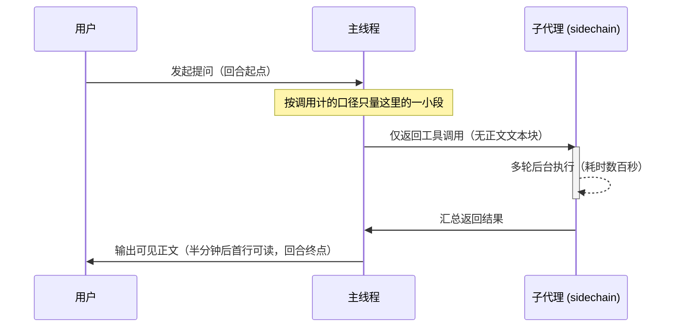

> 「差距不在模型之间」系列第二篇：模型没换，换的是它干活的方式；这一篇讲怎么发现换掉了什么。

「这模型最近两周很慢。」有人说这话时，我手上按调用计的每调用延迟（per-call latency）p50 曲线，过去几周基本是平的。人的体感在恶化，机器的读数却纹丝不动。两条曲线同时摆在桌上，排查就从这个分叉点开始。

## `localhost:4141` 上那台不能停的本地代理

怀疑最先落在本地代理上，毕竟怀疑自己的代码总是比怀疑上游容易。这台机器用 bun 跑着一个自建兼容前端，监听 `localhost:4141`，Claude Code 靠 `ANTHROPIC_BASE_URL` 走它，Codex 也走它。现场给了一条硬约束：正在跑的实例不许停。我只能在不打断流量的前提下，拿同一个请求分别直连后端和过代理各跑一次。

首字节与总时长都在噪声内，块间隔中位一个是 704 ms，一个是 703 ms。换上带二十个工具定义的大载荷，过代理反而更快，因为代理握着保活连接，直连每次都要重付握手。跑了二十多小时的老实例跟新起实例表现一致，后端并发按一到二十爬坡也是零错误。

代理没加延迟。

这个结论是对的，而它没有回答任何被问的问题。如果代理无罪，单次调用的曲线又是平的，那人到底在哪一段等烦了？回答体感变慢之前，我们得先写出报告者坐在屏幕前那段时间的两个端点；手上的指标不含这两端，它答的就是另一个问题。

## 重建一个月日志先坏两次量具

把两千多个会话文件捞出来重建历史时，我的量具先坏了两次。第一次我直接拿 jsonl 行数当 API 响应数。我没留意一条响应会拆成多条记录并共用同一个 `message.id`，所谓调用翻倍翻的只是内容块。第二次我只取每条响应的首条记录，结果 `output_tokens` 中位数被读成了 3，实际是 537，因为只有带 `stop_reason` 的收尾记录才写着结算用量。推断：响应拆成多条记录且仅 `stop_reason` 行带结算用量，系日志落盘所致，并非 API 层性质。依据是[流式协议把用量结算放在收尾事件里](https://docs.anthropic.com/en/api/messages-streaming)。

这里藏着一个未验证假设：Claude Code 的本地会话日志没有官方 schema。我对落盘形态的拆解，靠的是流式协议惯例加上本地文件的实际长相。这不是官方契约，换个客户端版本可能就不成立。它会动摇中位数读成 3 那段归因，好在不影响外层的回合序列本身。

真正昂贵的教训还在后头：那份坏数据已经喂给了一个正在跑的分析流程。运行期拒绝接收修正，报错说该 agent 不可达，我只能杀掉重发。一个坏量具的成本从来不是那个坏数字，是所有已经相信它的下游。聚合前先跑行数与去重 `message.id` 的比对，只认带 `stop_reason` 的结算行，成了我后来的死规矩。

## 为什么控干净的曲线还是骗了你？

修好解析器再看那二十多天的同模型窗口，sidechain 占比和开启思考的比例都在猛涨。我把样本锁进同模型、同触发条件、固定输出长度、剔除四个真事故日的受控格，按周延迟又走平了。把两期差异拆成比率变化与[构成效应（composition effect）](https://en.wikipedia.org/wiki/Kitagawa_decomposition)，构成项是比率项的十倍以上。严谨用错了分母，仍然是错的。

只是更难反驳。

分层把大部分效应消掉时，难道不该先问一句，被控掉的那个变量是不是答案本身？紧接着我又犯了第四个错：按峰值并发分桶，高并发那桶的墙钟中位慢六倍，我差点顺手写下「把并发封顶」的建议。推断：高并发那桶更慢是选择偏差，不是并发代价。依据是那批样本多半撞上事故日，剔除后延迟差缩回零点几秒，换个在途定义符号还会翻转。任务大才开一堆子代理，封顶不会缩小任务，只会把并行硬生生串起来。

切回以人为起点的回合表，一千四百多个回合终于把账对上了。

一回合的墙钟中位从 185.4 s 涨到了 530.2 s，同期主线程 API 调用次数却几乎没动。推断：回合变长的主因是回合结构变化，不是单次调用退化，依据就是墙钟涨近三倍而主线程调用数持平。当然，这只是观测数据上的归因，我们没法像受控实验那样把因果完全钉死。再往下拆，主线程响应里完全不含任何文本块的占比从 17.5% 涨到了 53.9%。最后一周哪怕只有六十几个回合，这个占比也还在高位。如下图所示，人发问后主线程只顾派发工具，子代理在后台跑上几百秒，屏幕前的人干等半分钟才盼来第一行字。

模型没变慢，它不说话了。

## 两套口径各自的边界

把分母换成回合，并不是要废掉请求表。在配额核算、超时截断、单请求服务等级目标（Service Level Objective、SLO）这些以单次调用为契约的场景里，按调用计的口径依然是唯一正确的尺子。反过来，哪怕建好了回合表，我手头这套日志也回答不了输出质量有没有退化，算不出大开子代理的投入产出比到底值不值。

更棘手的盲区留在数据结构的接缝里。算置信区间时，天是最小的独立单位，我们得用按天重采样的[聚类自助法（cluster bootstrap）](https://doi.org/10.3368/jhr.50.2.317)来算。而这里只有二十来天，区间本身也不稳。客户端版本号与日期高度共线，单个版本横跨十来天，我们根本没法把客户端改动与后端波动干净地剥离开。就连把子代理挂回主回合这件事都还没定案。按时间窗关联显示单响应墙钟在改善，换成按会话作用域关联，同一个指标的方向直接反过来。join 规则一天没钉死，子代理效率那笔账就不算真正结案。

---

- 上文：[先跑一回什么都不干的 /usr/bin/true](/notes/probe-a-noop-binary/) 是同一系列的第一篇，讲怎么先量出一台机器的进程创建地板，再判断「某工具慢」这个说法能不能成立。
- 旁支：[账本只能证明有人申报过](/notes/ledger-only-proves-a-claim/) 处理的是同一类错误——把执行者自报的数字当成事实，只是它发生在文件系统这一层。
- 下文：[一万行计划没教会 agent 停手，契约教会了](/notes/heterogeneous-agent-audit/) 从这里开始读，如果你更关心怎么让一个不在场的执行者在该停的时候停下来。
