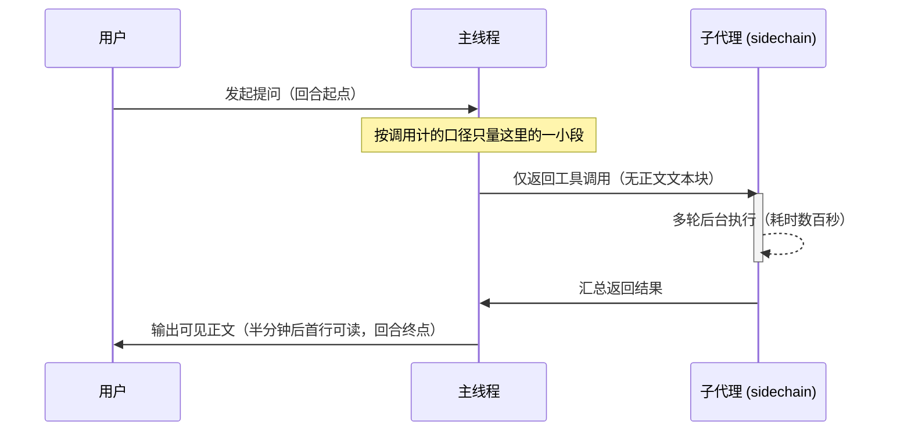

> 「差距不在模型之间」系列第二篇：模型没换，换的是它干活的方式；这一篇讲怎么发现换掉了什么。

「这模型最近两周很慢。」有人这么说的时候，我手上那条按调用计的 p50 延迟曲线（per-call latency），过去几周基本是平的。人觉得越来越慢，单次调用的读数却没动。这篇记的是我怎么找到两者之间差的那一段。

## `localhost:4141` 上那台不能停的本地代理

我先怀疑的是本地代理，怀疑自己的代码总比怀疑上游容易。这台机器用 bun 跑着一个自建的兼容前端，监听 `localhost:4141`，Claude Code 通过 `ANTHROPIC_BASE_URL` 走它，Codex 也走它。正在跑的实例不能停，所以我只能在不打断流量的前提下，拿同一个请求直连后端跑一次，过代理再跑一次。

两边的首字节时间和总时长都在噪声范围内，流式块间隔的中位数一个 704 ms、一个 703 ms。换成带二十个工具定义的大请求，过代理反而更快，因为代理复用了保活连接，直连每次都要重新握手。跑了二十多小时的老实例和新起的实例表现一样，后端并发从一爬到二十也没有报错。

所以代理没有加延迟。可这回答不了原来的问题：用户说的慢，是从他发出提问到屏幕上出现可读的回答这一整段，而我量的是其中的单次调用。指标的两个端点和用户等待的两个端点不一样，读数再准，答的也是另一个问题。

## 重建一个月日志，量具先坏了两次

接下来我把两千多个会话文件捞出来重建历史，量具先坏了两次。第一次我拿 jsonl 的行数当 API 响应数，没注意一条响应会拆成多条记录、共用同一个 `message.id`，看上去翻了倍的调用其实只是内容块。第二次我只取每条响应的第一条记录，`output_tokens` 的中位数读出来是 3，实际是 537：结算用量只写在带 `stop_reason` 的那条收尾记录里。这种拆法多半是客户端落盘时逐个事件写出来的，[流式协议本来就把用量结算放在收尾事件里](https://docs.anthropic.com/en/api/messages-streaming)，不是 API 本身的性质。

这个解释没法证实：Claude Code 的本地会话日志没有官方 schema，上面的拆解靠的是流式协议的惯例和文件的实际长相，换个客户端版本可能就不成立。好在它只影响「为什么会读成 3」，不影响后面用到的回合序列。

更麻烦的是，那份坏数据已经喂给了一个正在跑的分析流程。我想把修正发过去，运行时报错说那个 agent 不可达，只好杀掉重发。坏数字本身改一下就好，费事的是已经用了它的下游。从那以后，我聚合前都先比一下行数和去重后的 `message.id` 数，只认带 `stop_reason` 的结算行。

## 受控分组与构成效应

修好解析器后再看那二十多天的同模型窗口，sidechain（子代理）的占比和开启思考的比例都涨得很快。我把样本限定在同模型、同触发条件、固定输出长度，再剔除四个真出过事故的日子，按周看的延迟又平了。把两期的差异拆成比率变化和[构成效应（composition effect）](https://en.wikipedia.org/wiki/Kitagawa_decomposition)两部分，构成项是比率项的十倍以上。也就是说，变慢主要来自请求的构成变了，而我刚才控制掉的恰恰是构成，曲线当然是平的。

接着我又错了一次：按峰值并发分桶，高并发那桶的墙钟中位数慢六倍，我差点就写下「把并发封顶」的建议。这多半是选择偏差，不是并发本身的代价：那批样本大多落在事故日，剔掉之后两桶只差零点几秒，换一种「在途」的定义，差值的符号还会反过来。任务大才会开一堆子代理，封顶不会让任务变小，只会把本来并行的部分串起来。

最后我换成以人的提问为起点的回合表，一千四百多个回合，账对上了。一回合的墙钟中位数从 185.4 s 涨到 530.2 s，同期主线程的 API 调用次数几乎没变，所以回合变长主要是回合的结构变了，不是单次调用变慢；这仍是观测数据上的归因，没有受控实验那么硬。再往下拆，主线程响应里一个文本块都没有的占比从 17.5% 涨到 53.9%，最后一周只有六十几个回合，这个比例也还在高位。模型没变慢，它不说话了。

下图是这样一个回合：用户发问后，主线程只派发工具调用，子代理在后台跑上几百秒，屏幕前的人等了半分钟才看到第一行字。

## 两套口径各自的边界

回合表不替代请求表。配额核算、超时截断、单请求的服务等级目标（SLO），这些场景的契约本来就按单次调用定，按调用计的口径仍然是对的。反过来，回合表也有答不了的问题：这套日志看不出输出质量有没有退化，也算不出多开子代理到底划不划算。

还有几处没解决。算置信区间时，独立单位是天，要用按天重采样的[聚类自助法（cluster bootstrap）](https://doi.org/10.3368/jhr.50.2.317)，可这里只有二十来天，区间本身也不稳。客户端版本和日期高度共线，一个版本横跨十来天，客户端的改动和后端的波动分不开。子代理怎么挂回主回合也还没定：按时间窗关联，单响应墙钟在改善；按会话作用域关联，同一个指标方向相反。这条 join 规则定下来之前，子代理效率那笔账算不清。

---

- 上文：[先跑一回什么都不干的 /usr/bin/true](/notes/probe-a-noop-binary/) 是同一系列的第一篇，讲怎么先量出一台机器的进程创建地板，再判断「某工具慢」这个说法能不能成立。
- 旁支：[账本只能证明有人申报过](/notes/ledger-only-proves-a-claim/) 处理的是同一类错误——把执行者自报的数字当成事实，只是它发生在文件系统这一层。
- 下文：[一万行计划没教会 agent 停手，契约教会了](/notes/heterogeneous-agent-audit/) 从这里开始读，如果你更关心怎么让一个不在场的执行者在该停的时候停下来。
