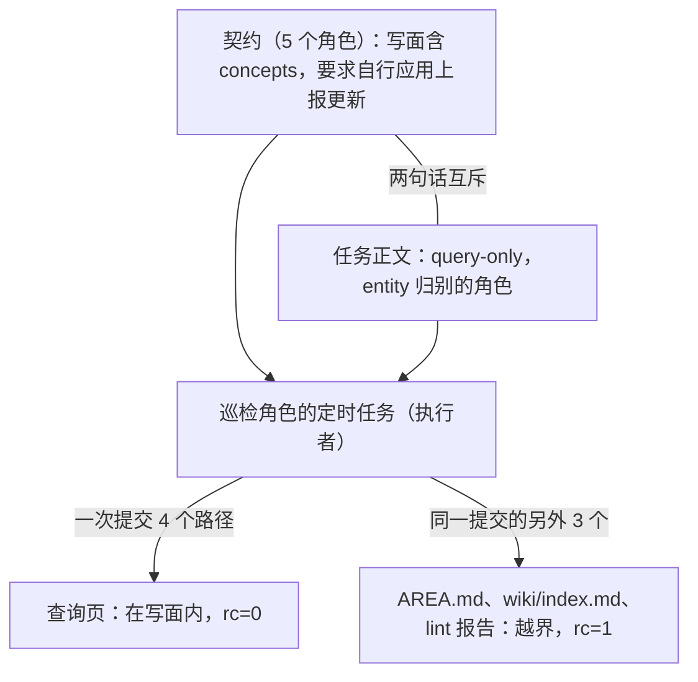

> 提交已同步不等于其中所有写入合规；`lint.py --apply` 是生成途径，不是替执行者扩展角色写面的授权。

一个巡检角色的定时任务把提交 `c625ce2` 同步到了远端，4 个变更路径里有 3 个越界。越界后该修哪一层、写面怎么定、diff 怎么验、产物与权限怎么分开判——这两次事故给出的答案都能照着做，而且都不在提示词里。

## 三个路径越界，为什么产物还能留？

事故发生在一个非人触发的巡检角色定时任务（执行者）上，操作对象是该角色自己的知识库仓。提交 `c625ce2` 总计 `+322/−9`。独立验收者（independent acceptance）拉取变更后，逐路径做程序复算，口径是 [Git 对 `--numstat` 逐路径增删行数的定义](https://git-scm.com/docs/git-log)。角色被契约允许写入的路径集合叫写面（write surface）。写面就是[最小权限原则](https://en.wikipedia.org/wiki/Principle_of_least_privilege)在文件系统路径上的具体化。写集合外的路径就是越界，复算结果如下表：

| 路径 | 增删行 | 写面检查 |
|---|---|---|
| 查询页 | +182/−0 | 在写面内（rc=0） |
| `AREA.md` | +1/−1 | 越界（rc=1） |
| `wiki/index.md` | +9/−8 | 越界（rc=1） |
| lint 报告 | +130/−0 | 越界（rc=1） |

按常规直觉，越界提交应该立刻回滚。独立验收者在内存里重生成了那三份越界输出，全程未调用写盘入口。比对发现，内存生成物与提交字节全等，该提交的 AREA 已无需再改写。知识库的页面人口、悬空引用、type/tier/area drift 前后一致，零新增悬空引用。

产物完全干净。

独立验收者把两件事分开裁决：保留越界产物，因为「回退只会重新引入旧计数和漏索引」。同时，越界事实绝不追认成授权。生成工具跑出正确结果，不代表调用生成工具的角色自动获得了目标路径的写权限。

最省事的解释是执行者没守规矩，无视了不许乱动其他目录的警告。顺着这个解释走，要修的就是提示词。这个解释错在假设上：把越界默认读成执行纪律问题。验收没有顺着它走，去翻了定义角色权责的另一处文本。如果真是执行纪律问题，为什么它偏偏只挑这几个特定文件越界？

## 互斥的两句话

翻开现役契约与任务正文（routine），两条规则迎头相撞。现役契约共声明 5 个角色，明确把 `wiki/concepts/**` 划入这个巡检角色的写面。任务注册表里，两个 concept 目标也都标着对应的 `writer` 与 `mode: apply_reported_update`，要求该任务自行应用上报更新。但定时任务每次启动必读的任务正文写着：别碰 query 写面之外的路径。entity 页归另一个角色，只上报、绝不编辑。

如下图所示，契约要求写，任务正文禁止写，两条上游指令同时压在同一个执行者头上，一次提交里就撞出了越界路径：



两句话互斥，执行者无论怎么做都会违背其中一侧。推断：越界是契约与正文互斥的必然结果，而不是执行者「不听话」；所以修执行者的提示词无效。依据是两份文本互斥，而当晚落地的修复也只动了任务正文与契约测试。不过，互斥能解释这次越界是必然；没有证据说它对每一次越界都是唯一根因。这条未验证假设，直接限制了本节归因的适用强度：互斥只能解释这一次，不能解释所有越界。

修复没有去给提示词叠感叹号，而是把交接（handoff）边界改写成机器与人都能逐条核对的前置条件：

- 精确路径在该任务的 `handoff_targets` 内；
- `kind` 属于 `entity/concept` 且落在当前角色写面内；
- 目标声明了对应的 `writer` 与 `mode`；
- 候选（candidate）字节与路径满足已批准的证据边界，且应用前已有独立验收记录。

> Do not self-accept. Without that acceptance, leave the candidate pending and do not edit the entity/concept page.

四条缺一，执行者就只能交出只记录拟增内容、路径、证据锚与验收状态的候选，不落盘。候选阶段不申请写前独占的租约（lease），不 apply，也不 commit。等另一个角色按[职责分离原则](https://en.wikipedia.org/wiki/Separation_of_duties)完成独立验收后，才带着写前租约、显式路径与应用后读回正式写盘。写盘之后，租约结清为 `NO_CHANGE` 或 `UPDATED`。修复后的任务正文同时写死了禁写清单（`AREA.md`、`wiki/index.md`、`_lint-reports/` 等），并钉死一条铁律：生成物不扩大执行者的写面（`A generated output does not expand the actor's write surface.`）。

修复提交 `facacdc` 当晚落地：任务正文变更 `+39/−11`，契约测试追加 `+110`（提交信息：`reconcile routine body with five-role contract (handoff guard, receipt semantics, no out-of-surface writes)`）。现在把命令跑一遍：

```bash
uv run --with pytest --with pyyaml pytest -q tests/harness/test_bot_materialize.py
```

`28 passed, 51 subtests passed`（[subtests 的计数口径](https://docs.pytest.org/en/stable/how-to/subtests.html)）。

路径锁死了。

## 路径全绿之后，越界藏去了哪？

两次事故提交的时间戳都落在 `14:08`，前后相隔整整一周。还是同一个巡检角色的定时任务，从同一个班次出发，交出了第二次提交 `7118472`。这一次，逐路径写面检查全绿通过：变更列表里干干净净，只改了一页允许它写的查询页。如果验收只看路径集合与退出码，这次班次已经算满分收工。

回执上写着「`frontmatter 仅 updated/last_accessed 改动`」。独立验收者不看回执结论，直接打开 diff 逐行清点。一数，实际被改动的字段有五个：`title`、`updated`、`sources`、`confidence`、`last_accessed`。其中 `sources` 从 2 项膨胀到 9 项，塞进来的新增 7 个 slug 在库里根本没有对应内容页；`confidence` 也被顺手从 `0.82` 抬到了 `0.84`。

再看知识库的机械门禁：页面数、悬空引用、drift、claim warnings 这些指标照旧一动没动。独立验收者当场驳回夹带，裁决恢复 `title`、`sources`、`confidence` 至原值，其他 frontmatter 不得夹带，并写明：「现有 lint 未报这些问题不构成通过。」你敢只看回执摘要和绿灯就放行定时任务的写入吗？

推断：一次契约修复没有终结问题，越界的对象从「文件」变成了「字段」，机械门禁对这一层保持沉默。依据是第二次提交的实际 diff，与毫无波动的 lint 指标形成的直接对比。这正好印证了上一节留下的那个疑虑：清除了文本互斥，并不等于一劳永逸地消除了越界。

字段级越界比文件级难防。文件级越界至少撞上了路径集合检查，脚本跑一遍就能抓出三个 `rc=1`。字段级越界藏在合法路径内部，回执里也看不出来，现有的逐路径检查和全文 lint 没有对应维度的探针。不掀开 diff 数那几行键值，那 7 个悬空的来源和虚高的置信度就会合法地沉淀进主分支。

## 越界之后按什么顺序下刀？

下一次再遇到「提示词里明明写了别动，agent 还是动了」，先忍住去改提示词的手。把上游契约、任务注册表和任务正文摆成左右两列，逐条核对契约允许什么、正文又要求什么。只要两处文本存在互斥，执行者就处在横竖都是错的死局里，修提示词只是在死局上再叠一层噪音。先把契约与任务正文对齐，把写面写成可检查的显式集合。一边列清允许写入的路径与字段条件；另一边把 `AREA.md`、`wiki/index.md` 这类容易被顺手牵羊的目标写进禁写清单。工具顺带产出的生成物，也一并拦在写面之外。

验收环节必须从执行者手里剥离出去。执行者在回执里自报「只改了某某字段」，往往是整条链路里风险最高的一句话。独立验收的动作不能停在看回执和看绿灯，必须打开 diff 逐路径、逐字段核对。机械门禁只检查编写者教过它的维度，门禁沉默只说明那一维还没写进规则，绝不构成合规证明。

发现越界后，产物处置与权限处置也要切开。独立核验过、字节与指标确实达标的产物可以留下，省去回退带来的旧计数与漏索引。但越界行为本身必须立案拦截，夹带的字段逐一还原；绝不把既成事实追认成下一次的默认授权。

这套做法有它绕不开的代价。

契约对齐、写前租约、候选隔离加上独立验收，整套链路很重；拿它去管一次性的人工单点小改动纯属浪费，它的边界只限于无人值守、定期自己写库的定时任务。哪怕在这些任务上，一次修复也不等于收工：一周后，越界就从文件换成了字段。只要机械门禁还没覆盖到字段语义，逐行对照 diff 的验收环节就省不掉。

---

- 上文：[一万行计划没教会 agent 停手，契约教会了](/notes/heterogeneous-agent-audit/)，「一张发给 Agent 的工牌」系列的入口篇：无人值守时，先给执行者划一条它自己就能判断的停手线。
- 下文：[账本只能证明有人申报过](/notes/ledger-only-proves-a-claim/)，顺着本文的验收问题往下走：怎么让验收不依赖执行者的口头申报。
- 旁支：这次是机械门禁沉默了一整周才被人抓到——「失败在无人知晓处」系列处理的是同一种失败方式：定时任务、同步与告警的共同毛病是不出声。
