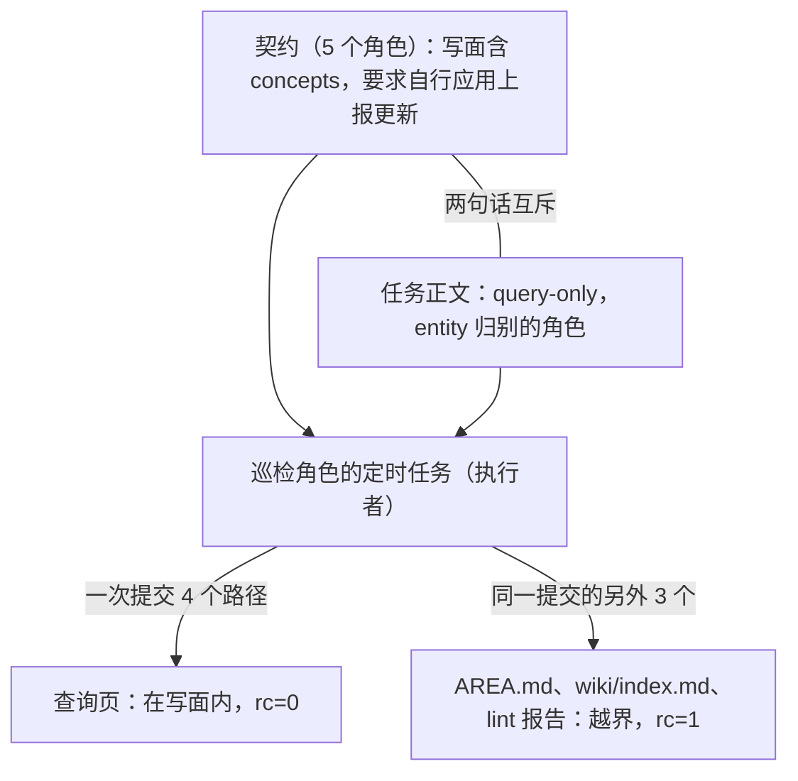

> 提交已同步不等于其中所有写入合规；`lint.py --apply` 是生成途径，不是替执行者扩展角色写面的授权。

这篇记同一个定时任务的两次越界。它属于一个巡检角色，下面叫执行者，往这个角色自己的知识库仓里写东西。第一次，它同步到远端的提交 `c625ce2` 改了 4 个路径，其中 3 个不在它被允许写的范围里。一周后的第二次，路径全对，但它在允许改的那一页里多改了三个字段，回执没提，lint 也没报。两次修的都不是提示词。

## 第一次：三个路径越界，产物却没问题

契约给每个角色规定了一组允许写入的路径，我们叫它写面，写面之外的写入就算越界。提交 `c625ce2` 一共 `+322/−9`。负责验收的是另一个角色，下面叫验收者。它拉下变更，按 [Git `--numstat` 对逐路径增删行数的定义](https://git-scm.com/docs/git-log)逐个路径复算，再对每个路径跑一遍写面检查，结果如下：

| 路径 | 增删行 | 写面检查 |
|---|---|---|
| 查询页 | +182/−0 | 在写面内（rc=0） |
| `AREA.md` | +1/−1 | 越界（rc=1） |
| `wiki/index.md` | +9/−8 | 越界（rc=1） |
| lint 报告 | +130/−0 | 越界（rc=1） |

越界的提交，一般的做法是回滚。验收者没有急着回滚，而是在内存里把那三份越界的输出重新生成了一遍，全程没有调用写盘入口。生成结果和提交里的字节完全一样，AREA 也不需要再改；知识库的页面数、悬空引用、type/tier/area drift 前后一致，没有新增悬空引用。也就是说，越界写进去的内容本身是对的。

所以验收者把两件事分开判：产物留下，因为「回退只会重新引入旧计数和漏索引」；越界这件事照样记下，不因为结果对就追认成授权。生成工具跑出了正确结果，不代表调用它的角色就有了目标路径的写权限。

剩下的问题是它为什么偏偏写了这三个文件。越界的恰好是这几个特定路径，不太像随手乱写，于是验收者去翻了规定角色权责的另一份文本。

## 契约和任务正文互相矛盾

现役契约声明了 5 个角色，明确把 `wiki/concepts/**` 划进这个巡检角色的写面；任务注册表里，两个 concept 目标也都标着对应的 `writer` 和 `mode: apply_reported_update`，意思是让这个任务自己把上报的更新应用进去。可定时任务每次启动都会读的任务正文（routine）写的是：别碰 query 写面之外的路径，entity 页归另一个角色，只上报，不编辑。

两份文本对同一个执行者给了相反的指令，一份要它写，一份不许它写：



这种情况下，执行者怎么做都要违背其中一份。所以这次越界是两份文本矛盾的必然结果，不是执行者不听话，改它的提示词没有用；当晚落地的修复也只动了任务正文和契约测试。不过这个解释只管这一次：没有证据说别的越界也是同一个原因。

修复没有在提示词里加警告，而是把交接（handoff）的边界写成了人和程序都能逐条核对的前置条件：

- 精确路径在该任务的 `handoff_targets` 内；
- `kind` 属于 `entity/concept` 且落在当前角色写面内；
- 目标声明了对应的 `writer` 与 `mode`；
- 候选（candidate）字节与路径满足已批准的证据边界，且应用前已有独立验收记录。

> Do not self-accept. Without that acceptance, leave the candidate pending and do not edit the entity/concept page.

缺一条，执行者就只交一份候选，记下拟增的内容、路径、证据锚和验收状态，不写盘。候选阶段不申请写前的独占租约（lease），不 apply，也不 commit。等另一个角色验收通过，它才拿着租约、显式路径和写后读回去正式写盘，写完之后租约结清为 `NO_CHANGE` 或 `UPDATED`。修复后的任务正文还列了一份禁写清单（`AREA.md`、`wiki/index.md`、`_lint-reports/` 等），并写明生成物不扩大执行者的写面：`A generated output does not expand the actor's write surface.`

修复提交 `facacdc` 当晚落地：任务正文改了 `+39/−11`，契约测试新增 `+110`，提交信息是 `reconcile routine body with five-role contract (handoff guard, receipt semantics, no out-of-surface writes)`。验证命令：

```bash
uv run --with pytest --with pyyaml pytest -q tests/harness/test_bot_materialize.py
```

输出是 `28 passed, 51 subtests passed`（[pytest 怎么计 subtests](https://docs.pytest.org/en/stable/how-to/subtests.html)），路径这一层算是管住了。

## 第二次：路径全对，字段越界

一周后，同一个定时任务在同一个班次交出了提交 `7118472`，时间戳和上次一样是 `14:08`。这次逐路径的写面检查全部通过，变更只有一页它有权写的查询页。如果验收只看路径和退出码，这次就过了。

回执写的是「`frontmatter 仅 updated/last_accessed 改动`」。验收者没有采信，打开 diff 一行行数，实际改了五个字段：`title`、`updated`、`sources`、`confidence`、`last_accessed`。`sources` 从 2 项变成 9 项，新加的 7 个 slug 在库里都没有对应的内容页；`confidence` 从 `0.82` 改成了 `0.84`。

知识库的机械门禁对此没有反应：页面数、悬空引用、drift、claim warnings 都没变。验收者驳回了夹带的改动，要求把 `title`、`sources`、`confidence` 恢复原值，其他 frontmatter 不许夹带，并写明：「现有 lint 未报这些问题不构成通过。」只看回执和 lint 的话，这次提交会原样合进主分支。

所以一次契约修复没有让越界消失，越界的对象从文件换成了字段，而现有门禁不查这一层；第二次提交的 diff 和没有变化的 lint 指标放在一起就能看出来。这也应了上一节留的那个限定：解决了两份文本的矛盾，不代表越界就不会再发生。

字段级的越界比文件级难抓。文件越界会被路径检查拦下，脚本一跑就是三个 `rc=1`；字段越界发生在允许写的文件里面，回执里看不出来，逐路径检查和全文 lint 也都不看字段。不打开 diff 数那几行键值，那 7 个不存在的来源和改高了的置信度就会照常进入主分支。

## 再遇到越界，按这个顺序查

下次再碰到「提示词里写了别动，agent 还是动了」，先别改提示词。把上游契约、任务注册表和任务正文并排放，逐条对照契约允许什么、正文要求什么。只要两边有矛盾，执行者怎么做都是错的，改提示词解决不了。先把契约和任务正文对齐，再把写面写成能检查的显式集合：一边列出允许写的路径和字段条件，一边把 `AREA.md`、`wiki/index.md` 这类容易被顺手改到的文件写进禁写清单，工具顺带生成的文件也不算在写面里。

验收交给另一个角色做，不让执行者自己验。第二次事故错就错在回执上：回执说两个字段，diff 里是五个。所以验收看 diff，按路径、按字段核对，不看回执和绿灯。门禁没报，只说明它不查这一项，不能当成合规的证据。

发现越界后，产物怎么处理和权限怎么处理分开判。独立核验过、字节和指标都没问题的产物可以留下，省得回退把旧计数和漏掉的索引带回来；越界本身照样记录在案，夹带的字段逐个还原，不因为这次结果对就当成下次的默认授权。

这套流程很重：契约对齐、写前租约、候选隔离、独立验收，拿来管一次性的人工小改动不划算，只值得用在无人值守、定期自己写库的定时任务上。机械门禁还不查字段语义，在补上之前，逐行对 diff 的验收省不了。

---

- 上文：[一万行计划没教会 agent 停手，契约教会了](/notes/heterogeneous-agent-audit/)，「一张发给 Agent 的工牌」系列的入口篇：无人值守时，先给执行者划一条它自己就能判断的停手线。
- 下文：[账本只能证明有人申报过](/notes/ledger-only-proves-a-claim/)，顺着本文的验收问题往下走：怎么让验收不依赖执行者的口头申报。
- 旁支：[模型没变慢，它不说话了](/notes/the-model-stopped-talking/)，同样是一种不出声的失败，只是换到了模型调用上：按调用计的延迟曲线是平的，一半以上的主线程响应里却一个字的正文都没有。
